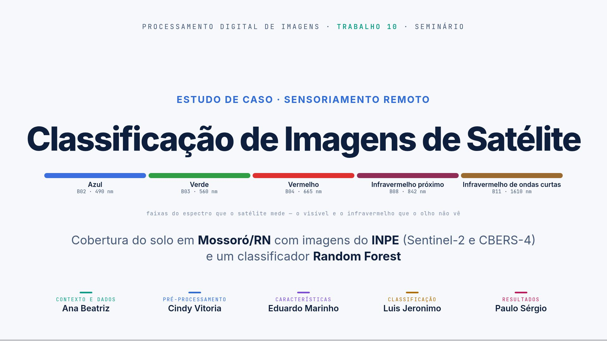
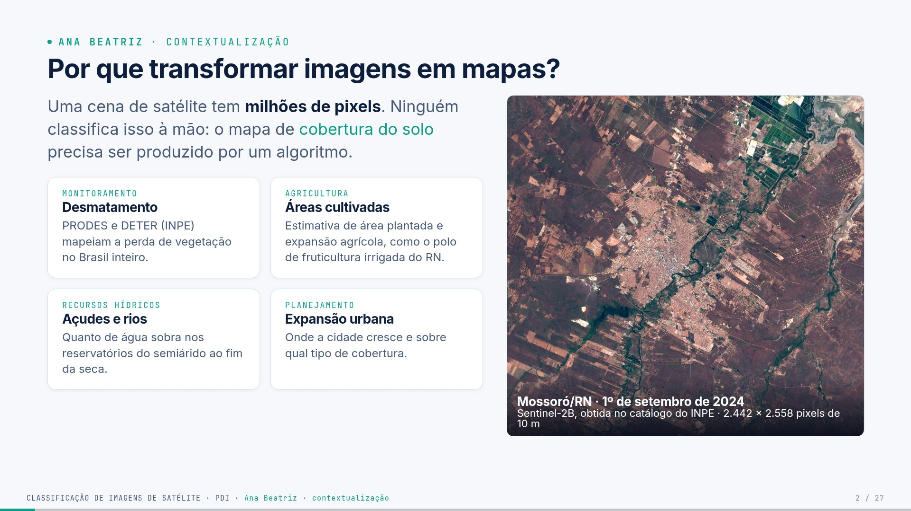
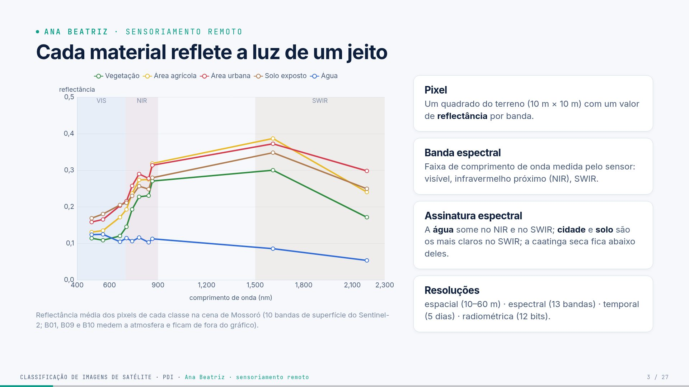
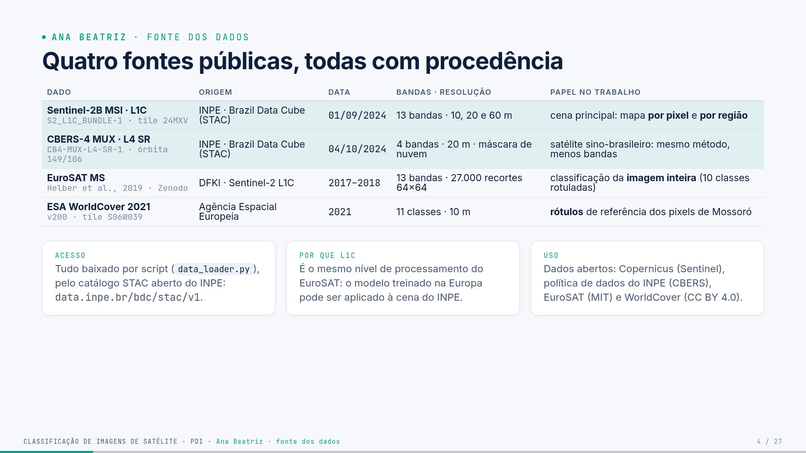
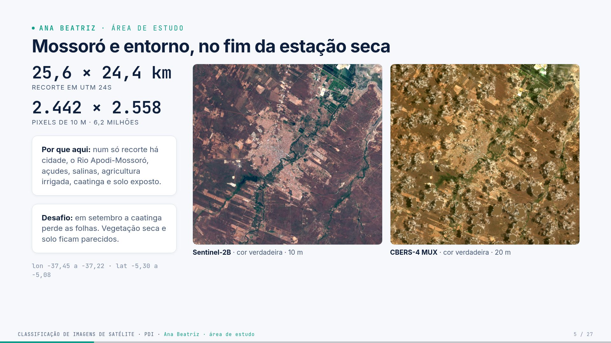
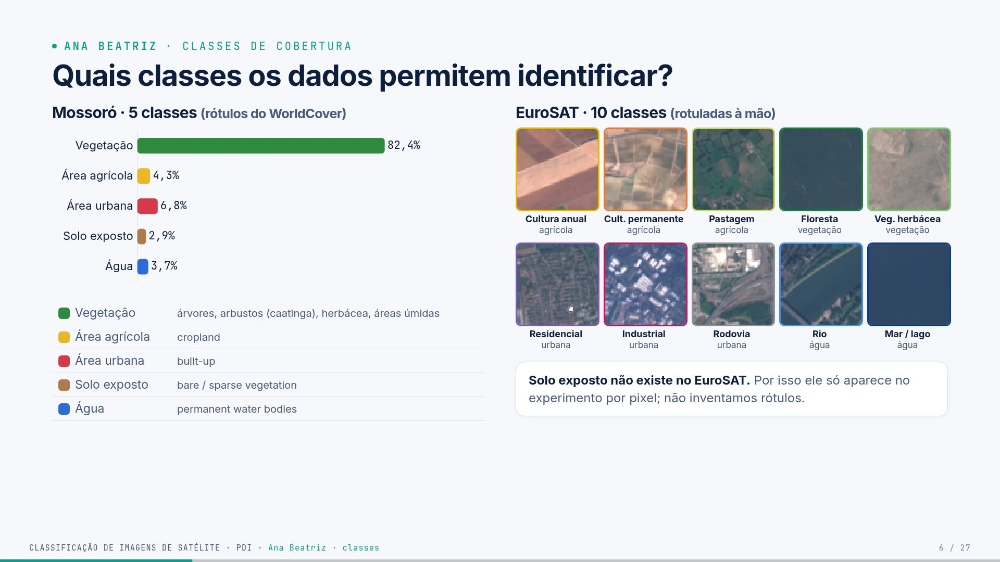

# Guia — Ana Beatriz · slides 1 a 6

**Seu papel:** abrir o seminário, apresentar o problema e mostrar de onde vêm os dados. Tempo-alvo:
~5 min. Seu bloco precisa deixar claro para o público o que é uma imagem multiespectral, quais dados
usamos e quais classes são viáveis.

## Parte 1 — O trabalho inteiro (todos precisam saber)

> Leia esta parte mesmo que seu trecho seja outro: o professor pode perguntar qualquer coisa a
> qualquer um. O passo a passo completo, com código, está no [guia geral](guia-geral.md).

**Em uma frase:** pegamos imagens de satélite do **INPE** sobre **Mossoró/RN**, transformamos
cada pixel em números (bandas, índices espectrais, textura) e treinamos um **Random Forest** que
diz se o pixel é **vegetação, área agrícola, área urbana, solo exposto ou água**, medindo o acerto
em partes da cena que o modelo nunca viu.

### Os dados

- **Sentinel-2B L1C** (INPE · Brazil Data Cube), 01/09/2024: 13 bandas, 10 m, 6,2 milhões de pixels.
- **CBERS-4 MUX** (INPE · Brazil Data Cube), 04/10/2024: 4 bandas (sem SWIR), 20 m.
- **EuroSAT MS**: 27.000 recortes 64×64 de 13 bandas, rotulados em 10 classes (Europa).
- **ESA WorldCover 2021**: mapa de 10 m usado como **gabarito** de cada pixel de Mossoró.

**As nove etapas** (cada uma é um arquivo em `src/`)

| # | etapa | o que acontece | quem apresenta |
|---|---|---|---|
| 1 | aquisição | baixa as cenas pelo catálogo STAC do INPE, recorta Mossoró, alinha as bandas em 10 m | Ana / Cindy |
| 2 | exploração | composições coloridas, assinaturas espectrais, proporção das classes | Ana / Cindy |
| 3 | pré-processamento | número digital → reflectância (com a correção de −1000), máscara de nuvem | Cindy |
| 4 | características | 22 números por pixel (bandas, NDVI, NDWI, MNDWI, NDBI, BSI, vizinhança 5×5); 97 por recorte | Eduardo |
| 5 | amostras | a cena é cortada em blocos de 1,28 km: treino, validação e teste nunca são vizinhos | Cindy |
| 6 | treino | Random Forest; hiperparâmetros escolhidos na validação | Luis |
| 7 | avaliação | acurácia, precisão, recall, F1, kappa, matriz de confusão, só no teste | Luis |
| 8 | mapa | todos os pixels classificados em ~27 s; filtro de moda 3×3 | Paulo |
| 9 | erros | mapa de erros, exemplos e causas | Paulo |

**Três níveis de classificação:** *imagem inteira* (1 recorte → 1 classe, EuroSAT), *por pixel*
(mapa de Mossoró) e *por região* (janela de 640 m deslizando pela cena com o modelo do EuroSAT).

**Os números principais** (teste)

| experimento | acurácia | kappa | F1-macro |
|---|---|---|---|
| imagem inteira · EuroSAT | 93,2% | 0,924 | 92,9% |
| pixel · Sentinel-2 | 88,6% (89,2% com filtro de moda) | 0,606 | 64,2% |
| pixel · CBERS-4 | 86,1% | 0,511 | 56,8% |
| região · EuroSAT → Mossoró | 62,8% de concordância | — | — |

Três lições que todos devem saber explicar:

1. **82% da área é vegetação**: por isso a acurácia é alta e o F1-macro, menor.
2. **NIR e SWIR importam**: sem eles, o EuroSAT cai de 93,2% para 85,6%, e o CBERS (sem SWIR)
   confunde cidade com solo.
3. **Vazamento espacial**: sortear pixels em vez de blocos inflaria o F1-macro de 64% para 73%.

---

## Parte 2 — Fundamentos do seu tema

### 2.1 Como um satélite "fotografa"

Um sensor **passivo** (como o MSI do Sentinel-2 ou a MUX do CBERS) mede a luz do Sol refletida
pela Terra. O sensor tem vários detectores, cada um sensível a uma faixa de comprimento de onda:
são as **bandas**. A imagem final não é uma foto colorida, e sim uma **pilha de imagens em tons de
cinza**, uma por banda. Em cada pixel há um número por banda.

```text
           banda B02 (azul)    banda B03 (verde)  ...  banda B12 (SWIR)
pixel (x,y):      0,11               0,11         ...       0,21        ← um vetor de 13 números
```

### 2.2 O espectro e o que o olho não vê

| faixa | comprimento de onda | bandas Sentinel-2 | por que importa |
|---|---|---|---|
| visível | 400–700 nm | B02 azul, B03 verde, B04 vermelho | cor que o olho vê; a clorofila absorve azul e vermelho |
| borda do vermelho | 700–780 nm | B05, B06, B07 | transição rápida da reflectância da vegetação |
| infravermelho próximo (NIR) | 780–900 nm | B08, B8A | a folha sadia reflete muito; a água absorve |
| infravermelho de ondas curtas (SWIR) | 1500–2300 nm | B11, B12 | sensível à umidade; solo e construções são claros |
| atmosfera | 443, 945, 1375 nm | B01, B09, B10 | aerossol, vapor d'água, nuvens altas |

### 2.3 Assinatura espectral (a base de toda a classificação)

Se colocarmos a reflectância de um alvo em cada banda num gráfico, obtemos uma curva: a
**assinatura espectral**. Na nossa cena (slide 3):

- **água** quase não reflete no NIR (0,03) nem no SWIR (0,02);
- **cidade e solo** são os mais claros no SWIR (~0,37);
- **caatinga seca** reflete pouco no vermelho e moderadamente no NIR; sem folhas, ela fica
  parecida com o solo, e esse é o grande desafio da cena;
- **agricultura irrigada** é clara no NIR (folhas verdes) e no SWIR.

### 2.4 Resoluções

- **Espacial:** tamanho do pixel no terreno. 10 m no S2 (bandas principais), 20 m no CBERS MUX.
  Uma casa (10 × 10 m) cabe num pixel do S2; no CBERS ela se mistura com a rua.
- **Espectral:** número e largura das bandas. 13 no S2 contra 4 no CBERS.
- **Temporal:** revisita de 5 dias (Sentinel-2A + 2B); 26 dias para o CBERS-4 MUX.
- **Radiométrica:** 12 bits no MSI (4096 níveis).

### 2.5 Classificação supervisionada em uma imagem

1. Temos exemplos com a resposta (rótulos).
2. O algoritmo aprende a relação entre os números e a classe.
3. Aplicamos a todos os pixels e obtemos o **mapa temático** (cada classe com uma cor).

### 2.6 Os dados em detalhe

| | Sentinel-2B MSI | CBERS-4 MUX |
|---|---|---|
| agência | ESA (Europa), distribuído pelo INPE | INPE + CAST (China), lançado em 2014 |
| bandas | 13 (visível, borda do vermelho, NIR, SWIR, atmosfera) | 4 (azul, verde, vermelho, NIR) |
| resolução | 10, 20, 60 m | 20 m |
| nível usado | L1C (topo da atmosfera) | L4 SR (superfície, corrigida) |
| cena | 01/09/2024, tile 24MXV, 0% de nuvem | 04/10/2024, órbita 149/106, 2,3% de nuvem |
| coleção no INPE | `S2_L1C_BUNDLE-1` | `CB4-MUX-L4-SR-1` |

O **Brazil Data Cube** é o projeto do INPE que organiza imagens de vários satélites num catálogo
padronizado (STAC). Um catálogo STAC é uma "lista" consultável por endereço web: perguntamos
"quais imagens existem sobre esta coordenada nesta data?" e ele devolve os links dos arquivos.

**EuroSAT** (Helber et al., 2019): 27.000 recortes de 64×64 px (640 m) de 34 países europeus,
rotulados em 10 classes, com 13 bandas. Licença MIT.

**ESA WorldCover 2021:** mapa global de 10 m, produzido pela ESA com Sentinel-1 e Sentinel-2.
Serve de gabarito por pixel. Licença CC BY 4.0.

---

## Parte 3 — Slide a slide (o que dizer)

## Slide 1 · Capa



**O que aparece:** título, a **faixa do espectro** e os cinco integrantes, cada um com a cor
da sua seção (essa cor aparece no rótulo de cada slide e na barra de progresso).

**A faixa colorida embaixo do título** representa as cinco faixas do espectro que o satélite mede e
que mais usamos, da esquerda para a direita: **azul** (B02, 490 nm), **verde** (B03, 560 nm),
**vermelho** (B04, 665 nm), **infravermelho próximo** (B08, 842 nm) e **infravermelho de ondas
curtas** (B11, 1610 nm). As duas últimas o olho não vê, e são justamente as que mais ajudam a
classificar. É o resumo visual do trabalho: classificar usando luz que não vemos. Se perguntarem,
explique isso em uma frase. A mesma faixa volta no slide de agradecimento.

**Fala:**
> "Boa tarde. Nosso trabalho é um estudo de caso real de classificação de imagens de
> satélite. Usamos imagens do INPE sobre Mossoró e treinamos um classificador que diz,
> para cada pixel, se ali há vegetação, área agrícola, cidade, solo exposto ou água.
> Cada um de nós vai apresentar uma etapa: eu começo pelo contexto e pelos dados."

---

## Slide 2 · Por que transformar imagens em mapas?



**Ideia central:** uma cena tem milhões de pixels (a nossa tem 6,2 milhões) e ninguém
classifica isso à mão. O mapa de cobertura do solo precisa sair de um algoritmo.

**Explicação:**

- *Cobertura do solo* é o que existe fisicamente na superfície (floresta, água, asfalto).
  *Uso do solo* é o que o homem faz ali (pastagem, indústria). O EuroSAT mistura os dois
  conceitos ("land use and land cover").
- PRODES e DETER são programas do INPE: o PRODES mede o desmatamento anual da Amazônia,
  o DETER emite alertas quase diários. Ambos classificam imagens de satélite.
- A imagem à direita é a nossa cena real (Sentinel-2B, 01/09/2024), em cor verdadeira.

**Fala:**
> "O INPE monitora o desmatamento do país inteiro com imagens de satélite. Nenhum analista
> olha pixel por pixel: são algoritmos de classificação. Esta é a nossa cena: Mossoró,
> setembro de 2024, com 6,2 milhões de pixels de 10 metros. A pergunta do trabalho é
> como transformar esta imagem num mapa com a área de cada classe."

---

## Slide 3 · Cada material reflete a luz de um jeito



**O que aparece:** reflectância média de cada classe em 10 bandas do Sentinel-2, calculada
com **os nossos pixels**: 20.000 por classe, rótulos do WorldCover
(`presentation/scripts/exportar_dados.py`, função `scene_signatures`).

**Como ler o gráfico:**

- **Água** (azul): reflete pouco em tudo e quase nada no NIR e no SWIR, porque a água absorve o infravermelho.
- **Urbano e solo** (vermelho, marrom): os mais claros no SWIR (1610 e 2190 nm).
- **Vegetação** (verde): na estação seca, a caatinga perde as folhas e fica **abaixo**
  da cidade e do solo no SWIR. O "salto" do NIR (borda do vermelho, 700–800 nm) existe,
  mas é menor do que numa floresta verde.
- **Agrícola** (amarelo): alto no NIR (campos irrigados, folhas verdes) e no SWIR.

**Conceitos para dominar:**

- **Pixel:** área do terreno (10 m × 10 m nas bandas principais) com um valor por banda.
- **Resolução espacial** (tamanho do pixel), **espectral** (quantas bandas e quão estreitas),
  **temporal** (revisita: 5 dias com Sentinel-2A + 2B), **radiométrica** (12 bits no MSI).

**Fala:**
> "Este gráfico não é de livro: foi calculado com os nossos pixels. Cada linha é uma
> classe. A água quase some no infravermelho; cidade e solo exposto são os mais claros no
> SWIR. Se as curvas fossem iguais, nenhum algoritmo separaria as classes. É essa
> diferença que o classificador vai aprender."

**Por que B01, B09 e B10 ficaram de fora?** Elas medem a atmosfera (aerossol, vapor d'água,
cirros), não a superfície. Entram como características do modelo, mas atrapalhariam a leitura do gráfico.

---

## Slide 4 · Quatro fontes públicas, todas com procedência



| dado | o que é | para que serve |
|---|---|---|
| Sentinel-2B L1C | cena completa do tile 24MXV, baixada do **Brazil Data Cube (INPE)**, coleção `S2_L1C_BUNDLE-1` | mapa por pixel e por região |
| CBERS-4 MUX L4 SR | satélite **sino-brasileiro**, câmera MUX (4 bandas, 20 m), coleção `CB4-MUX-L4-SR-1` | comparar com um sensor sem SWIR |
| EuroSAT MS | 27.000 recortes 64×64 com 13 bandas, rotulados à mão (Helber et al., 2019) | classificar a imagem inteira |
| ESA WorldCover 2021 | mapa global de 10 m da Agência Espacial Europeia | rótulo (gabarito) de cada pixel de Mossoró |

**Pontos-chave:**

- O acesso é **por script** (`src/data_loader.py`), pelo catálogo STAC do INPE, que é
  aberto e não exige cadastro. Cada cena é identificada pelo ID do item, então o
  experimento é reprodutível.
- **Por que L1C?** O EuroSAT foi feito com L1C. Usar o mesmo nível de processamento
  permite aplicar o modelo do EuroSAT à cena do INPE (slide 23).
- **Licenças:** Copernicus (Sentinel) é livre e aberto; o INPE distribui CBERS gratuitamente;
  EuroSAT é MIT; WorldCover é CC BY 4.0.

**Fala:**
> "O professor pediu dados do INPE. As duas cenas vêm do Brazil Data Cube, o catálogo
> oficial do INPE: uma do Sentinel-2 e uma do CBERS-4, o satélite feito em parceria com a
> China. O que o INPE não tem é um gabarito pixel a pixel para Mossoró; por isso usamos o
> WorldCover como referência. E o EuroSAT é o conjunto rotulado que usamos para
> classificar imagens inteiras."

---

## Slide 5 · Mossoró e entorno, no fim da estação seca



- Recorte de **25,6 × 24,4 km** em UTM zona 24 Sul, o mesmo sistema das duas cenas.
- **2.442 × 2.558 pixels** de 10 m = 6,2 milhões de pixels.
- Num só recorte: cidade, Rio Apodi-Mossoró, açudes, **salinas** (canto superior direito),
  agricultura irrigada, caatinga e solo exposto.
- **Desafio:** setembro é fim da estação seca. A caatinga perde as folhas, e vegetação seca e
  solo ficam parecidos.
- As duas imagens estão na **mesma grade**: um pixel do CBERS (20 m) cobre exatamente 2×2
  pixels do Sentinel-2 (`data_loader.aoi_grid`).
- A cena CBERS tem nuvens pequenas (cúmulos): elas são mascaradas (slide 10).

**Fala:**
> "Escolhemos Mossoró porque, num recorte de 25 quilômetros, aparecem todas as classes:
> cidade, rio, açudes, salinas, agricultura e caatinga. A imagem é de setembro, no fim da
> seca. Isso dificulta, porque a caatinga sem folhas fica parecida com solo."

---

## Slide 6 · Quais classes os dados permitem identificar?



**Mensagem:** antes de treinar, verificamos o que é viável.

- **Mossoró (5 classes):** vêm do WorldCover. Árvores, arbustos (a caatinga), vegetação
  herbácea, áreas úmidas e mangue viram *Vegetação*; cropland vira *Área agrícola*; built-up
  vira *Área urbana*; bare/sparse vira *Solo exposto*; água permanente vira *Água*
  (`config.WORLDCOVER_TO_CLASS`).
- **Desbalanceamento:** 82,4% da área é vegetação. Isso muda a forma de amostrar e de medir
  (Cindy e Luis vão mostrar).
- **EuroSAT (10 classes):** agrupadas nas macro-classes do trabalho (`config.EUROSAT_TO_MACRO`).
  Pastagem foi agrupada em *Área agrícola* porque é um uso agropecuário do solo.
- **Solo exposto não existe no EuroSAT.** A classe entra só no experimento por pixel. Não inventamos rótulos.

**Fala (com transição):**
> "Das cinco classes que queríamos, todas existem na referência de Mossoró, mas uma não
> existe no EuroSAT: solo exposto. Em vez de inventar rótulos, ela fica só no experimento
> por pixel. E o gráfico mostra o maior desafio: 82% da área é vegetação. Agora a Cindy
> vai mostrar como esses dados foram preparados antes de qualquer classificação."

---

---

## Parte 4 — Exemplos com números reais (para usar se perguntarem)

**Um pixel de água e um de cidade, na cena de Mossoró:**

| banda | água (2095, 80) | cidade (1336, 937) |
|---|---|---|
| B02 azul | 0,116 | 0,172 |
| B03 verde | 0,105 | 0,182 |
| B04 vermelho | 0,065 | 0,201 |
| B08 NIR | **0,033** | 0,331 |
| B11 SWIR | **0,019** | **0,371** |

A água "some" no NIR e no SWIR; a cidade é a mais clara justamente no SWIR. Com só essas duas
bandas, já daria para separar esses dois pixels.

**Tamanho dos dados:** a área de estudo tem 2.442 × 2.558 = 6.246.636 pixels. Com 13 bandas, são
81 milhões de números só para uma data.

**Proporção das classes na área (pixels de referência):** vegetação 5.147.971 (82,4%), urbana
424.140 (6,8%), agrícola 266.161 (4,3%), água 228.259 (3,7%), solo exposto 180.105 (2,9%).

---

## Parte 5 — Perguntas prováveis e respostas

### "Por que não usaram o catálogo de imagens do INPE (dgi.inpe.br)?"

O Brazil Data Cube também é do INPE e expõe as mesmas cenas por uma API padronizada (STAC),
o que permite baixar por script, sem interação manual, e fixar a cena pelo ID.
Usamos as coleções do Sentinel-2 e do CBERS-4 que ele distribui.

### "Qual a diferença entre CBERS e Sentinel-2?"

CBERS-4 é o satélite sino-brasileiro (INPE/CAST, lançado em 2014). A câmera MUX tem 4
bandas (azul, verde, vermelho, NIR) com 20 m. O Sentinel-2 (ESA) tem 13 bandas, com o
SWIR, de 10 a 60 m. Usar os dois permite medir o valor das bandas SWIR (slide 20).

### "Por que o WorldCover e não o MapBiomas?"

O WorldCover tem 10 m, a mesma resolução do Sentinel-2, e um único arquivo cobre a área.
O MapBiomas (30 m, Landsat) seria uma ótima alternativa, mais adaptada ao Brasil, e está
nas melhorias (slide 25).

### "O que é EuroSAT e por que é europeu?"

É um benchmark científico (Helber et al., 2019, IEEE JSTARS): 27.000 recortes Sentinel-2
de 34 países europeus, rotulados à mão. Não existe conjunto equivalente, público e com 13
bandas, para o Brasil. Mostramos o efeito disso na classificação por região (slide 23).

### "A imagem tem nuvem?"

A cena Sentinel-2 tem 0% de nuvem no tile. A CBERS-4 tem cúmulos pequenos (8,7% da área de
estudo), removidos pela máscara de nuvem que o próprio INPE distribui.

### "O que é o Brazil Data Cube?"

Um projeto do INPE que organiza imagens de satélite (Sentinel-2, CBERS, Landsat, Amazonia-1) em
coleções padronizadas, com um catálogo STAC aberto. Usamos duas dessas coleções.

### "Por que a imagem de setembro e não de uma época chuvosa?"

Setembro é o fim da seca no semiárido: céu limpo (0% de nuvem no tile). Na época de chuva, as
cenas têm muita nuvem. O custo é que a caatinga sem folhas se parece com o solo, e isso aparece nos erros.

### "O que é a faixa colorida da capa?"

São as cinco faixas do espectro que mais usamos, da esquerda para a direita: azul (490 nm),
verde (560 nm), vermelho (665 nm), infravermelho próximo (842 nm) e infravermelho de ondas curtas
(1610 nm). As duas últimas o olho não vê, mas são as que mais ajudam a classificar.

### "Qual a diferença entre cobertura e uso do solo?"

Cobertura é o que está fisicamente na superfície (vegetação, água, asfalto). Uso é a atividade
humana (pastagem, indústria). O satélite mede cobertura; o uso é inferido.

---

## Parte 6 — Transição para a Cindy

> "…Agora a Cindy vai mostrar como esses dados foram preparados antes de qualquer classificação."
---

## Checklist antes do seminário

- [ ] Sei explicar a faixa colorida da capa (azul, verde, vermelho, NIR, SWIR).
- [ ] Sei dizer por que usamos WorldCover e EuroSAT além das cenas do INPE.
- [ ] Sei os números da área: 25,6 × 24,4 km, 6,2 milhões de pixels, 82% de vegetação.
- [ ] Li a **Parte 1** e sei explicar o trabalho inteiro em 1 minuto.
- [ ] Sei os números da minha parte sem olhar.
- [ ] Ensaiei a transição para o próximo integrante.
- [ ] Abri os slides (`presentation/index.html`) e testei `S` (notas) e `T` (tema).
