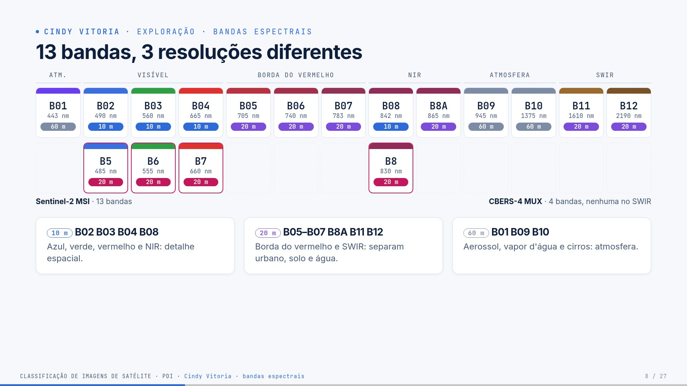
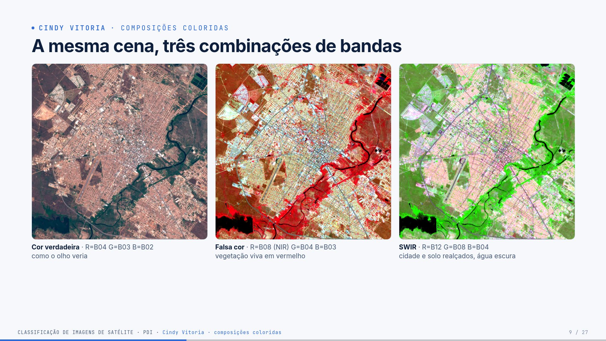
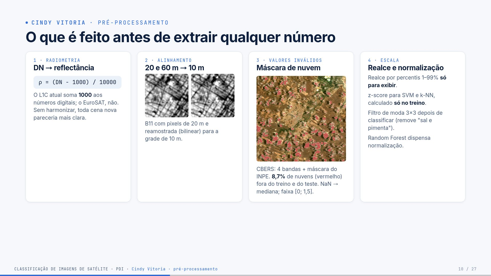
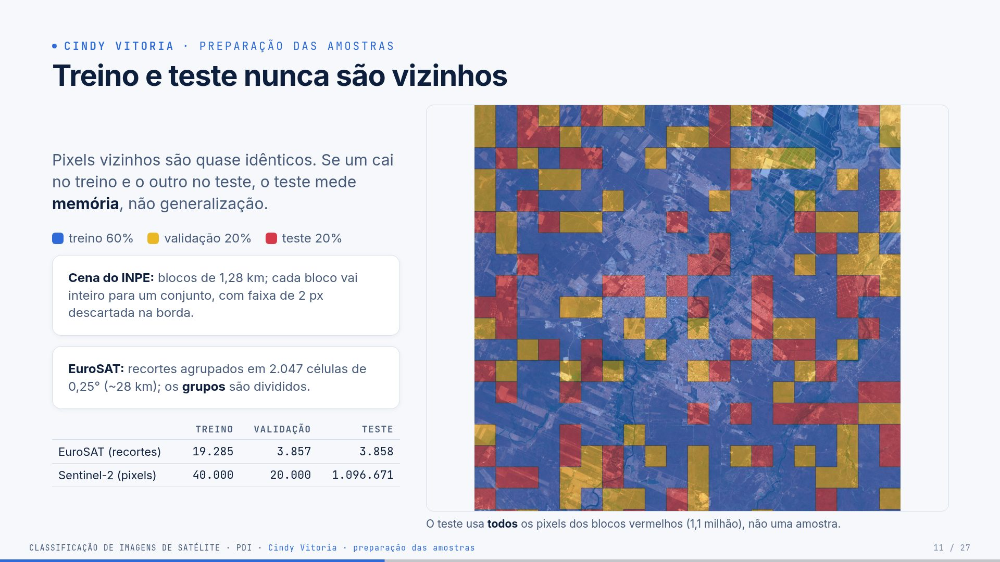

# Guia — Cindy Vitoria · slides 7 a 11

**Seu papel:** mostrar o caminho do dado bruto até as amostras prontas para treinar. Tempo-alvo: ~5
min. Você recebe a palavra da Ana depois das classes e entrega para o Eduardo com as amostras
separadas.

## Parte 1 — O trabalho inteiro (todos precisam saber)

> Leia esta parte mesmo que seu trecho seja outro: o professor pode perguntar qualquer coisa a
> qualquer um. O passo a passo completo, com código, está no [guia geral](guia-geral.md).

**Em uma frase:** pegamos imagens de satélite do **INPE** sobre **Mossoró/RN**, transformamos
cada pixel em números (bandas, índices espectrais, textura) e treinamos um **Random Forest** que
diz se o pixel é **vegetação, área agrícola, área urbana, solo exposto ou água**, medindo o acerto
em partes da cena que o modelo nunca viu.

### Os dados

- **Sentinel-2B L1C** (INPE · Brazil Data Cube), 01/09/2024: 13 bandas, 10 m, 6,2 milhões de pixels.
- **CBERS-4 MUX** (INPE · Brazil Data Cube), 04/10/2024: 4 bandas (sem SWIR), 20 m.
- **EuroSAT MS**: 27.000 recortes 64×64 de 13 bandas, rotulados em 10 classes (Europa).
- **ESA WorldCover 2021**: mapa de 10 m usado como **gabarito** de cada pixel de Mossoró.

**As nove etapas** (cada uma é um arquivo em `src/`)

| # | etapa | o que acontece | quem apresenta |
|---|---|---|---|
| 1 | aquisição | baixa as cenas pelo catálogo STAC do INPE, recorta Mossoró, alinha as bandas em 10 m | Ana / Cindy |
| 2 | exploração | composições coloridas, assinaturas espectrais, proporção das classes | Ana / Cindy |
| 3 | pré-processamento | número digital → reflectância (com a correção de −1000), máscara de nuvem | Cindy |
| 4 | características | 22 números por pixel (bandas, NDVI, NDWI, MNDWI, NDBI, BSI, vizinhança 5×5); 97 por recorte | Eduardo |
| 5 | amostras | a cena é cortada em blocos de 1,28 km: treino, validação e teste nunca são vizinhos | Cindy |
| 6 | treino | Random Forest; hiperparâmetros escolhidos na validação | Luis |
| 7 | avaliação | acurácia, precisão, recall, F1, kappa, matriz de confusão, só no teste | Luis |
| 8 | mapa | todos os pixels classificados em ~27 s; filtro de moda 3×3 | Paulo |
| 9 | erros | mapa de erros, exemplos e causas | Paulo |

**Três níveis de classificação:** *imagem inteira* (1 recorte → 1 classe, EuroSAT), *por pixel*
(mapa de Mossoró) e *por região* (janela de 640 m deslizando pela cena com o modelo do EuroSAT).

**Os números principais** (teste)

| experimento | acurácia | kappa | F1-macro |
|---|---|---|---|
| imagem inteira · EuroSAT | 93,2% | 0,924 | 92,9% |
| pixel · Sentinel-2 | 88,6% (89,2% com filtro de moda) | 0,606 | 64,2% |
| pixel · CBERS-4 | 86,1% | 0,511 | 56,8% |
| região · EuroSAT → Mossoró | 62,8% de concordância | — | — |

Três lições que todos devem saber explicar:

1. **82% da área é vegetação**: por isso a acurácia é alta e o F1-macro, menor.
2. **NIR e SWIR importam**: sem eles, o EuroSAT cai de 93,2% para 85,6%, e o CBERS (sem SWIR)
   confunde cidade com solo.
3. **Vazamento espacial**: sortear pixels em vez de blocos inflaria o F1-macro de 64% para 73%.

---

## Parte 2 — Fundamentos do seu tema

### 2.1 Do arquivo ao número físico

O satélite não grava "reflectância": grava um **número digital (DN)** inteiro, para economizar
espaço. A conversão é uma conta simples, definida pelo fornecedor:

| produto | fórmula | exemplo |
|---|---|---|
| Sentinel-2 L1C (baseline ≥ 04.00, a nossa cena) | ρ = (DN − 1000) / 10000 | DN 3310 → ρ = 0,231 |
| EuroSAT (2017–2018, baseline antiga) | ρ = DN / 10000 | DN 2310 → ρ = 0,231 |
| CBERS-4 MUX L4 SR | ρ = DN × 0,0001 | DN 2265 → ρ = 0,227 |

A constante −1000 está no metadado do pacote (`MTD_MSIL1C.xml`, campo `RADIO_ADD_OFFSET`). Esse é
um ponto que pouca gente percebe: sem ele, o modelo treinado no EuroSAT receberia valores
deslocados e erraria por isso.

### 2.2 Reamostragem (alinhamento espacial)

As bandas têm pixels de tamanhos diferentes. Para empilhá-las, todas precisam ir para a **mesma
grade**. Isso exige calcular o valor em posições novas:

- **vizinho mais próximo:** copia o valor do pixel mais próximo. Usado em **rótulos**, que são
  categorias (não existe "meio caminho" entre água e cidade).
- **bilinear:** média ponderada dos 4 vizinhos. Usado em **reflectância**, que é contínua.
- **moda:** a categoria mais frequente. Usada para levar o WorldCover de 10 m para 20 m (CBERS).

Escolhemos uma grade em UTM 24S com origem em múltiplos de 20 m: assim 1 pixel CBERS = 2×2 pixels S2.

### 2.3 Valores inválidos e máscaras

- **Sem dado:** borda da cena (DN 0 no S2, −9999 no CBERS).
- **Saturado:** DN 65535 (o sensor "estourou").
- **Nuvem:** o INPE distribui com o CBERS uma máscara (**CMASK**): 127 = limpo, 255 = nuvem/sombra.
  Na nossa área, 8,7% é nuvem.
- Pixels inválidos ficam **fora** do treino, do teste e do mapa (`valid_mask`). Valores NaN ou
  infinitos viram a mediana da banda; a reflectância fica limitada a [0; 1,5].

### 2.4 Realce de contraste × normalização

- **Realce por percentis** (só para exibir): os valores entre os percentis 1% e 99% são esticados
  para 0–255. Sem isso, a imagem fica escura. Na cor verdadeira, usamos os **mesmos limites nas três
  bandas**, porque a névoa da atmosfera deixa o azul mais claro e a imagem ficaria magenta.
- **Normalização z-score** (para o modelo): (x − média)/desvio. Necessária para SVM e k-NN, que
  medem distâncias. A média e o desvio são calculados **só no treino**. O Random Forest não precisa:
  ele compara cada característica com um limiar, e esticar a escala não muda a comparação.

### 2.5 Filtros

- **Mediana** (antes de classificar): remove ruído impulsivo. Não foi necessária.
- **Moda 3×3** (depois de classificar): cada pixel recebe a classe mais frequente da vizinhança
  3×3. Remove pixels isolados e sobe a acurácia de 88,6% para 89,2%.

### 2.6 Treino, validação e teste

| conjunto | para que serve | quando é usado |
|---|---|---|
| treino | o modelo aprende | `fit` |
| validação | escolher hiperparâmetros (ex.: tamanho mínimo da folha) | comparação de 4 configurações |
| teste | medir o resultado final | **uma vez**, no fim |

### 2.7 Vazamento espacial (o conceito mais importante do seu bloco)

A **autocorrelação espacial** é a tendência de lugares próximos serem parecidos. Um pixel de
caatinga tem vizinhos de caatinga quase idênticos. Se treino e teste são sorteados pixel a pixel,
cada pixel de teste tem um "irmão" no treino, e o modelo acerta por memória. A solução é sortear
**regiões inteiras** (blocos) e deixar uma faixa de separação.

---

## Parte 3 — Slide a slide (o que dizer)

## Slide 7 · Nove etapas, cada uma com código próprio

**O que aparece:** as 9 etapas pedidas pelo professor, cada uma com o módulo Python
correspondente em `src/`, e embaixo as **três granularidades** de classificação.

| etapa | módulo | o que faz |
|---|---|---|
| 1 Aquisição | `data_loader.py` | baixa EuroSAT, cenas do INPE e WorldCover; recorta e alinha |
| 2 Exploração | `figures.py` | composições, assinaturas, proporções |
| 3 Pré-processamento | `preprocessing.py` | reflectância, máscaras, realce, filtros |
| 4 Características | `feature_extraction.py` | índices, estatísticas, textura |
| 5 Amostras | `sampling.py` | divisão espacial e amostragem |
| 6 Treino | `train.py` | Random Forest, ajuste na validação |
| 7 Avaliação | `evaluation.py` | métricas no teste |
| 8 Mapa | `predict.py` | classifica a cena inteira e por região |
| 9 Erros | `figures.py` | mapa de erros e exemplos |

**As três granularidades (o professor pediu essa distinção):**

- **Imagem inteira:** um recorte de 640 m recebe **um** rótulo (EuroSAT).
- **Por pixel:** cada pixel de 10 m recebe uma classe, e o resultado é um mapa temático (cena do INPE).
- **Por região:** uma janela de 64×64 px desliza sobre a cena e cada janela recebe uma classe.

**Fala:**
> "O pipeline tem nove etapas, e cada uma é um módulo de código que pode ser rodado
> sozinho. O mesmo pipeline serve para três níveis de classificação: a imagem inteira, o
> pixel e a região. Guardem essa diferença; o Paulo compara as três no final."

---

## Slide 8 · 13 bandas, 3 resoluções diferentes

**O que aparece:** o espectro de 400 a 2300 nm, com a posição e a largura de cada banda do
Sentinel-2 (cor = resolução) e, embaixo, as 4 bandas do CBERS-4 MUX.

| resolução | bandas | uso |
|---|---|---|
| 10 m | B02 azul, B03 verde, B04 vermelho, B08 NIR | detalhe espacial, NDVI |
| 20 m | B05, B06, B07 (borda do vermelho), B8A (NIR estreito), B11 e B12 (SWIR) | vegetação, solo, urbano, água |
| 60 m | B01 (aerossol), B09 (vapor d'água), B10 (cirros) | atmosfera |

**Exploração dos dados:** foi aqui que verificamos que as bandas chegam em grades
diferentes. A B11 tem um quarto dos pixels da B04, então, antes de empilhar, tudo precisa
ir para a mesma grade.

**Fala:**
> "O Sentinel-2 mede 13 faixas do espectro, mas não com a mesma nitidez: as do visível e
> o NIR têm 10 metros, as do SWIR têm 20 e as atmosféricas, 60. O CBERS-4 tem só 4 bandas
> e nenhuma no SWIR. Vamos ver que isso faz diferença para separar a cidade do solo."

---

## Slide 9 · A mesma cena, três combinações de bandas

Recorte de 8 × 8 km no centro de Mossoró (`figures.ZOOM_S2`).

| composição | R, G, B | o que destaca |
|---|---|---|
| cor verdadeira | B04, B03, B02 | como o olho veria |
| falsa cor | B08 (NIR), B04, B03 | vegetação viva em **vermelho**: a folha reflete muito o NIR |
| SWIR | B12, B08, B04 | cidade e solo em tons claros/rosados; água preta |

**Implementação:** `preprocessing.composite` escolhe as bandas pelo **papel físico**
(`red`, `nir`, `swir2`…) e aplica um realce por percentis. Na cor verdadeira, o realce
usa os **mesmos limites nas três bandas** (`joint=True`); sem isso, a névoa da atmosfera no
azul deixava a cena magenta.

**Fala:**
> "A mesma cena com três combinações de bandas. Na falsa cor, a mata do rio fica
> vermelho-vivo porque a folha verde reflete muito o infravermelho. Essas composições são
> para o humano interpretar. O classificador não vê cores: recebe os números de todas as bandas."

---

## Slide 10 · O que é feito antes de extrair qualquer número

1. **DN → reflectância** (`to_reflectance`, `harmonize_l1c`).
   O arquivo guarda números inteiros (DN). Reflectância = DN / 10000. **Detalhe sutil:**
   desde a baseline de processamento 04.00 (janeiro de 2022), a ESA soma 1000 aos DN do L1C
   (`RADIO_ADD_OFFSET = −1000` no metadado `MTD_MSIL1C.xml`). O EuroSAT é de 2017–2018, sem
   esse deslocamento. Sem corrigir, toda cena nova pareceria 0,1 mais clara em todas as bandas.
2. **Alinhamento espacial** (`data_loader.prepare_s2_scene`).
   As bandas de 20 e 60 m são reamostradas por interpolação **bilinear** para a grade de 10 m.
   A referência (WorldCover) usa **vizinho mais próximo** (10 m) ou **moda** (20 m, CBERS),
   porque rótulo é categórico: não existe "média" entre água e cidade.
3. **Valores inválidos** (`valid_mask`, `fix_invalid`).
   S2: DN 0 = sem dado, 65535 = saturado. CBERS: −9999 = sem dado, e a máscara **CMASK** do
   INPE marca nuvem e sombra (8,7% da área). Esses pixels ficam fora do treino, do teste e do
   mapa. NaN/inf vira a mediana da banda; os valores ficam limitados a [0; 1,5].
4. **Escala.**
   O realce por percentis serve **só para exibir**. O z-score (média 0, desvio 1) é usado
   para SVM e k-NN e é **calculado só no treino** (senão o teste vaza para o treino). O Random
   Forest dispensa normalização: cada árvore compara uma característica com um limiar, e a
   escala não muda a ordem dos valores. Depois de classificar, o **filtro de moda 3×3** remove
   pixels isolados.

**Redução de ruído:** há um filtro de mediana disponível (`denoise_median`), mas ele não foi
aplicado. As imagens L1C não têm ruído impulsivo, e o filtro borraria bordas de quadras e
estradas. O filtro que de fato ajuda é o de moda, **depois** da classificação.

**Fala:**
> "Quatro cuidados antes de calcular qualquer característica. Primeiro: converter número
> digital em reflectância, e aqui há um detalhe — desde 2022 a ESA soma mil aos valores;
> sem corrigir, o modelo treinado no EuroSAT veria tudo mais claro. Segundo: alinhar as
> bandas numa grade só. Terceiro: tirar pixels sem dado e nuvens; no CBERS usamos a máscara
> que o próprio INPE fornece. Quarto: a escala. O realce serve só para exibir; o Random
> Forest nem precisa de normalização."

---

## Slide 11 · Treino e teste nunca são vizinhos

**Ideia mais importante do seu bloco: vazamento espacial.** Pixels vizinhos são quase
idênticos. Se um vai para o treino e o vizinho para o teste, o teste mede **memória**.

**Cena do INPE** (`sampling.block_split_map`):

- a cena é cortada em blocos de **1,28 km** (128 px no Sentinel-2);
- cada bloco vai **inteiro** para treino (60%), validação (20%) ou teste (20%), por sorteio com semente fixa;
- uma faixa de **2 px** na borda de cada bloco é descartada, porque a característica de contexto usa
  uma janela 5×5 e não pode "ver" pixels de outro conjunto (há um teste automatizado para isso).

**EuroSAT** (`sampling.spatial_split`):

- cada recorte tem coordenada (é GeoTIFF); os recortes são agrupados em **células de 0,25°** (~28 km);
- `StratifiedGroupKFold` separa os **grupos** mantendo a proporção das classes;
- resultado: 19.285 / 3.857 / 3.858 recortes em 2.047 células.

**Amostragem dos pixels de treino** (`sample_pixels_sqrt`): 40.000 pixels, proporcionais à
**raiz da frequência** de cada classe. Testamos três formas no mesmo teste:

| amostragem | acurácia | F1-macro | o que acontece |
|---|---|---|---|
| balanceada (8.000 por classe) | 77,5% | 58,4% | superestima as classes raras (agrícola com precisão ~0,2) |
| proporcional | 91,2% | 60,0% | quase ignora as raras |
| **raiz da frequência** | 88,6% | **64,2%** | meio-termo, melhor F1-macro |

A **validação** (20.000 pixels aleatórios) só escolhe hiperparâmetros. O **teste** usa
**todos** os 1.096.671 pixels dos blocos de teste, não uma amostra.

**Fala (com transição):**
> "Este é o cuidado mais importante do trabalho. Se eu sorteio pixels, o vizinho de um pixel
> de treino cai no teste, e o modelo acerta porque decorou. Por isso cortamos a cena em
> blocos de 1,28 quilômetro: cada bloco vai inteiro para treino, validação ou teste. O
> teste usa todos os pixels dos blocos vermelhos, mais de um milhão. Com as amostras
> prontas, o Eduardo mostra quais números saem de cada pixel."

---

---

## Parte 4 — Exemplos com números reais

**Harmonização:** um pixel de água tem DN 1330 na banda B08 da cena de 2024.

- Correto: (1330 − 1000)/10000 = **0,033**.
- Sem a correção: 1330/10000 = 0,133, quatro vezes mais claro e parecido com solo úmido.

**Reamostragem da B11 (20 m → 10 m):** cada pixel de 20 m vira 4 de 10 m. A bilinear suaviza a
transição (imagens do slide 10). A cena final tem 2.442 × 2.558 px em todas as 13 bandas.

**Blocos:** com blocos de 128 px, a cena tem 20 × 20 = 400 blocos. Cerca de 60% vão para treino,
20% para validação e 20% para teste. O teste ficou com 1.096.671 pixels válidos.

**Amostragem pela raiz da frequência (por que funciona):** vegetação tem ~29 vezes mais pixels que
solo exposto. Com amostra proporcional, o treino teria 29 pixels de vegetação para cada pixel de
solo; com a raiz, √29 ≈ 5,4. As classes raras ficam representadas sem ser exageradas.

| amostragem | acurácia | F1-macro |
|---|---|---|
| balanceada | 77,5% | 58,4% |
| proporcional | 91,2% | 60,0% |
| raiz da frequência | 88,6% | 64,2% |

**Efeito do vazamento:** com divisão aleatória de pixels, o F1-macro iria a 73,0% (com blocos, 64,2%).

---

## Parte 5 — Perguntas prováveis e respostas

### "Por que interpolação bilinear e não vizinho mais próximo nas bandas?"

A reflectância é contínua; a bilinear evita os degraus de 20 m. Nos rótulos, que são
categóricos, usamos vizinho mais próximo ou moda.

### "Por que não fizeram correção atmosférica?"

Porque o modelo do EuroSAT foi treinado em L1C (topo da atmosfera). Manter o mesmo nível
evita uma diferença sistemática entre treino e aplicação. A cena CBERS já vem corrigida (L4 SR).

### "Por que o realce não entra no classificador?"

O realce por percentis depende de cada imagem: o mesmo alvo teria valores diferentes em
duas cenas. O classificador recebe a reflectância física.

### "O que aconteceria sem a divisão por blocos?"

Medimos: com a divisão aleatória de pixels, o F1-macro do Sentinel-2 sobe de 64,2% para
73,0% sem o modelo ser melhor. É o otimismo do vazamento (o Luis mostra no slide 19).

### "Por que blocos de 1,28 km?"

São grandes o bastante para conter campos e quadras inteiros e pequenos o bastante para que
haja centenas deles (o sorteio fica representativo). O EuroSAT usa células de ~28 km porque
os recortes estão espalhados por 34 países.

### "Por que descartar a faixa de 2 px?"

A característica de contexto usa a vizinhança 5×5 (raio de 2 px). Sem a faixa, um pixel
de treino na borda carregaria informação dos pixels de teste do bloco ao lado.

### "O que é UTM?"

Projeção cartográfica que divide a Terra em fusos de 6°. Em cada fuso, as coordenadas são em
metros, o que facilita medir áreas e trabalhar com pixels quadrados. Mossoró está no fuso 24 Sul.

### "Por que não aplicaram o filtro de mediana?"

As imagens L1C não têm ruído impulsivo (pixels "sal e pimenta" do sensor). Filtrar borraria bordas
finas, como ruas e canais. O filtro útil foi o de moda, depois da classificação, quando o ruído é de rótulos.

### "A validação e o teste não são a mesma coisa?"

Não. A validação é consultada várias vezes para escolher a configuração; por isso ela "contamina"
a escolha. O teste fica guardado e só é usado uma vez, para o número final.

### "Por que 1,28 km?"

Um bloco desse tamanho contém campos e quadras inteiros, e ainda há 400 blocos na cena, o que
deixa o sorteio representativo. Blocos muito pequenos não evitariam o vazamento; muito grandes
deixariam poucas classes raras no teste.

---

## Parte 6 — Transição para o Eduardo

> "…Com as amostras prontas, o Eduardo mostra quais números saem de cada pixel."
---

## Checklist antes do seminário

- [ ] Sei explicar o deslocamento de −1000 do L1C e por que ele importa.
- [ ] Sei diferenciar bilinear, vizinho mais próximo e moda.
- [ ] Sei explicar vazamento espacial com um exemplo.
- [ ] Li a **Parte 1** e sei explicar o trabalho inteiro em 1 minuto.
- [ ] Sei os números da minha parte sem olhar.
- [ ] Ensaiei a transição para o próximo integrante.
- [ ] Abri os slides (`presentation/index.html`) e testei `S` (notas) e `T` (tema).
