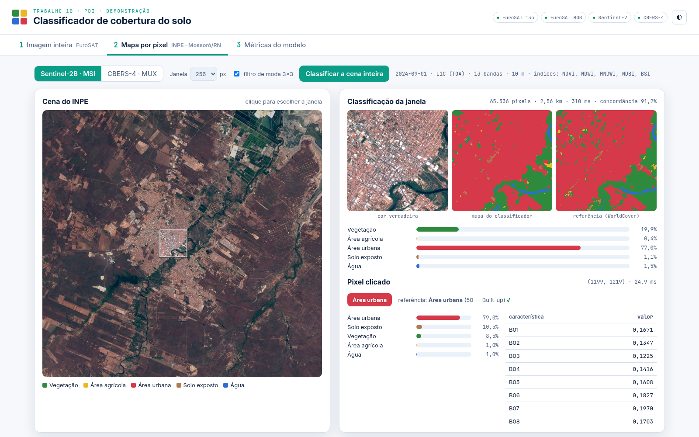
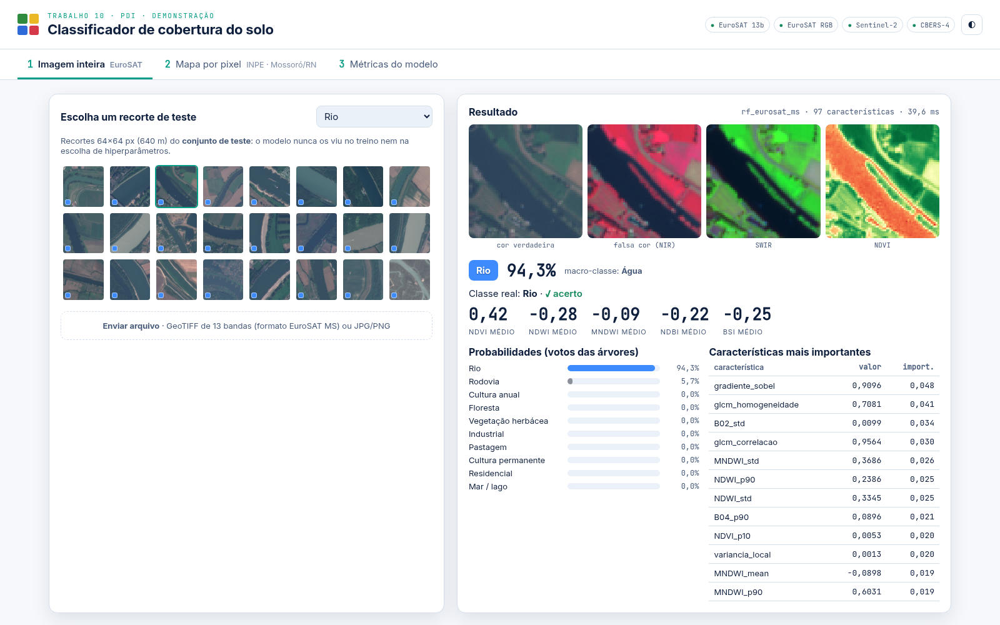

# Guia da demonstração — como usar e entender a interface

A interface mostra o classificador **funcionando de verdade**: cada clique envia um pedido ao
servidor Python, que roda o modelo treinado e devolve a resposta e o tempo gasto. Nenhum
resultado está gravado na página.



## 1. Como abrir

```bash
cd trab-10
.venv/bin/python src/app.py
```

Abra **<http://localhost:5000>** no navegador. No terminal aparece a lista de modelos carregados
(✓ ou ✗). Se algum estiver ✗, rode antes `.venv/bin/python src/train.py`.

No alto da página, as **pílulas verdes** (EuroSAT 13b, EuroSAT RGB, Sentinel-2, CBERS-4) confirmam
que os quatro modelos estão disponíveis. O botão ◐ (ou a tecla `T`) troca o tema; as teclas
`1`, `2` e `3` trocam de aba.

**O que acontece por trás:**

```text
navegador (web/app.js) ──pedido──► Flask (src/app.py) ──► predict.py ──► modelo .joblib
           ◄──── JSON: classe, probabilidades, características, imagens em base64, tempo (ms)
```

## 2. Aba 1 — Imagem inteira (EuroSAT)



**O que é classificado:** um recorte de 64×64 pixels (640 m × 640 m) com 13 bandas. O modelo dá
**uma** classe para o recorte inteiro, entre as 10 do EuroSAT.

### À esquerda: escolher o recorte

- A grade mostra **240 recortes do conjunto de teste** (24 por classe). Eles foram separados
  antes do treino e nunca foram usados para treinar nem para ajustar o modelo
  (`train.save_demo_samples`). Por isso, o acerto que aparece é honesto.
- O quadradinho colorido no canto de cada miniatura indica a classe real.
- O seletor no topo filtra por classe.
- **Enviar arquivo:**
  - **GeoTIFF de 13 bandas** (formato EuroSAT MS, por exemplo um arquivo de
    `data/raw/EuroSAT_MS/River/`): usa o modelo multiespectral completo;
  - **JPG/PNG** comum: usa o modelo **só RGB** (sem NIR, sem SWIR, sem índices). A imagem é
    reduzida para 64×64, e os tons de 0–255 são convertidos em reflectância por uma calibração
    linear estimada no próprio EuroSAT (correlação ≥ 0,993). O resultado é menos confiável (85,6%
    de acurácia no teste, contra 93,2%).

### À direita: o resultado

| elemento | como ler |
| --- | --- |
| cabeçalho (`rf_eurosat_ms · 97 características · 40 ms`) | modelo usado, tamanho do vetor e tempo da inferência |
| 4 imagens | **cor verdadeira** (como o olho veria); **falsa cor** (NIR em vermelho: vegetação viva fica vermelha); **SWIR** (cidade e solo claros, água escura); **NDVI** (verde = vegetação, vermelho = sem vegetação) |
| etiqueta colorida + porcentagem | classe prevista e **fração das árvores que votou nela** (confiança) |
| macro-classe | agrupamento nas classes do trabalho (ex.: Rio → Água) |
| "Classe real: … ✓ acerto / ✗ erro" | comparação com o rótulo do EuroSAT |
| números grandes (NDVI, NDWI…) | média de cada índice no recorte: NDVI alto = vegetação; MNDWI positivo = água; NDBI alto = construído/solo |
| barras de probabilidade | votos das 300 árvores em cada classe |
| tabela de características | as 12 características mais importantes do modelo, com o **valor neste recorte** e a importância geral |

**Como interpretar a confiança:** acima de ~80% o caso é claro; entre 35% e 60% o recorte é
ambíguo (por exemplo, rodovia passando por zona residencial). Os erros do teste costumam ter
confiança baixa, mas não sempre: houve uma rodovia chamada de industrial com 99% (o recorte tem
mais galpão que estrada).

**O que mostrar:** filtre "Rio", clique num recorte e mostre a falsa cor (rio preto, margens
vermelhas), o MNDWI positivo e "✓ acerto". Depois filtre "Rodovia" e procure um erro: ele mostra
que a confusão entre classes urbanas é real.

## 3. Aba 2 — Mapa por pixel (cenas do INPE)

**O que é classificado:** cada pixel da cena de Mossoró. Cada pixel recebe uma das 5 classes:
🟩 Vegetação · 🟨 Área agrícola · 🟥 Área urbana · 🟫 Solo exposto · 🟦 Água.

### Barra de ferramentas

| controle | efeito |
| --- | --- |
| **Sentinel-2B · MSI / CBERS-4 · MUX** | escolhe a cena (13 bandas a 10 m ou 4 bandas a 20 m) |
| **Janela 128 / 256 / 512 px** | tamanho do pedaço a classificar (256 px = 2,56 km no S2, 5,12 km no CBERS) |
| **filtro de moda 3×3** | liga/desliga o pós-processamento que remove pixels isolados |
| **Classificar a cena inteira** | roda o modelo em todos os pixels (~30 s no S2, ~7 s no CBERS) |
| texto à direita | data, nível, bandas, resolução e índices disponíveis no sensor |

### Painel esquerdo: a cena

- Imagem em cor verdadeira da área de estudo. **Clique em qualquer ponto**: o quadrado branco
  marca a janela que será classificada, centrada no clique.
- Depois de "Classificar a cena inteira", o mapa aparece por cima da imagem. O link "alternar
  mapa/imagem" troca entre os dois. Embaixo aparecem o tempo, o número de pixels, a concordância
  com a referência e a **área de cada classe em km²**.
- No CBERS, pixels com **nuvem** (máscara do INPE) aparecem escuros no mapa e não são classificados.

### Painel direito, em cima: a janela

| elemento | como ler |
| --- | --- |
| `65.536 pixels · 2,56 km · 310 ms · concordância 91,2%` | pixels classificados agora, lado da janela, tempo e % de pixels iguais à referência |
| três imagens | **cor verdadeira**, **mapa do classificador** e **referência (WorldCover)**: compare as duas últimas lado a lado |
| barras | porcentagem da janela em cada classe, segundo o modelo |

**Atenção:** a concordância da janela inclui pixels de blocos de **treino**. A medida oficial,
só com blocos de teste, está na aba 3 (88,6%). Use a janela para mostrar o funcionamento, não para
medir o desempenho.

### Painel direito, embaixo: o pixel clicado

| elemento | como ler |
| --- | --- |
| `(1199, 1219) · 25 ms` | coluna e linha do pixel na cena; tempo |
| etiqueta | classe prevista para este pixel |
| "referência: Área urbana (50 — Built-up) ✓" | classe do WorldCover (com o código original) e se coincide |
| barras | votos das 200 árvores |
| tabela | as **22 características** do pixel (10 no CBERS): bandas, índices e contexto 5×5 |

**Como ler as características de um pixel:**

- **B08 alto e B04 baixo** → NDVI alto → vegetação verde.
- **MNDWI > 0** → água.
- **B11/B12 altos** (SWIR) → cidade ou solo.
- **NDVI_desvio5x5 alto** → vizinhança heterogênea (bordas, quadras); baixo → área homogênea
  (açude, campo).

### Roteiro sugerido (aba 2)

1. Com o Sentinel-2, clique no **centro da cidade**: a janela fica quase toda vermelha e concorda
   cerca de 90% com a referência.
2. Clique no **rio**: aparecem a linha azul e a mata ciliar verde. No pixel, o MNDWI é positivo.
3. Clique nas **salinas** (canto superior direito): o modelo separa água (azul) de solo exposto
   (marrom), e é ali que estão as maiores confusões.
4. Desligue o **filtro de moda** e clique de novo: o mapa fica "salpicado". Religue para comparar.
5. Troque para o **CBERS-4** no mesmo lugar: o mapa fica mais grosseiro (20 m) e confunde mais
   cidade com solo (sem SWIR).
6. Se houver tempo, **Classificar a cena inteira**.

## 4. Aba 3 — Métricas do modelo

Mostra os números oficiais, medidos **só no conjunto de teste**, para cada experimento:

| elemento | como ler |
| --- | --- |
| acurácia · kappa · F1-macro · amostras de teste | resumo do desempenho (ver guia do Luis) |
| tabela por classe | precisão, recall, F1 e suporte (quantas amostras de teste da classe) |
| matriz de confusão | linha = classe real; coluna = prevista; números em % da linha. Verde na diagonal = acertos; vermelho fora dela = confusões |
| comparações (EuroSAT) | RF × SVM × k-NN × RF só RGB × divisão aleatória, no mesmo teste |
| por região | concordância do modelo do EuroSAT aplicado em Mossoró (62,8%) |

## 5. Perguntas que o professor pode fazer durante a demo

**"Isso está classificando agora ou é uma imagem pronta?"** Agora. O tempo de cada resposta
aparece na tela (ms). Dá para provar trocando o tamanho da janela ou desligando o filtro de moda:
o resultado muda na hora.

**"Por que o pixel diz uma coisa e a referência outra?"** Pode ser erro do modelo ou da referência
(de 2021, com cerca de 77% de acurácia). Mostre a cor verdadeira: muitas vezes a imagem de 2024 dá
razão ao modelo (um loteamento novo, um açude que secou).

**"Por que a confiança é 50%?"** Metade das árvores votou numa classe e o resto se dividiu. É um
pixel de transição (borda) ou uma classe ambígua (pousio × caatinga seca).

**"E se eu enviar uma foto qualquer?"** O modelo só RGB vai responder uma das 10 classes do
EuroSAT, mas o resultado só faz sentido para imagens de satélite vistas de cima, com resolução
parecida (~10 m por pixel).

## 6. Se algo der errado

| problema | solução |
| --- | --- |
| página não abre | o servidor não está rodando: `.venv/bin/python src/app.py` |
| pílula vermelha / "Modelo não encontrado" | rode `.venv/bin/python src/train.py` |
| aba 2 demora na primeira vez | normal: a cena é carregada na memória (~3 s) |
| porta 5000 ocupada | feche o outro programa ou mude a porta no fim de `src/app.py` |
| sem tempo ou sem computador | use as capturas `presentation/img/demo_imagem.png`, `demo_interface.png` e `demo_metricas.png` |
