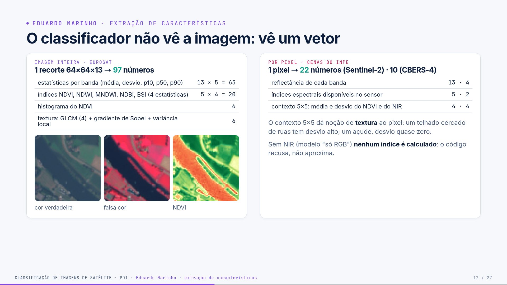
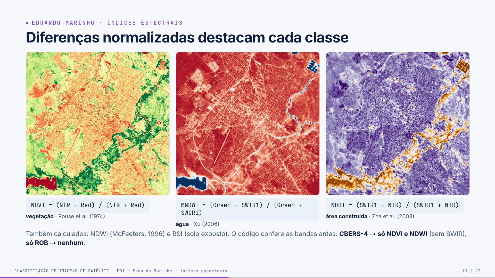
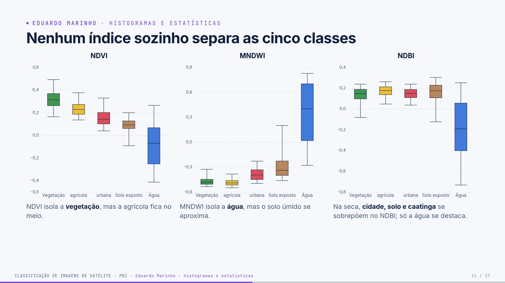
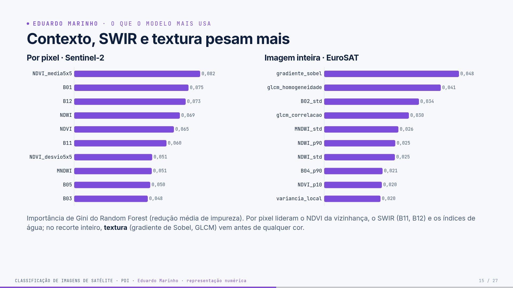

# Guia — Eduardo Marinho · slides 12 a 15

**Seu papel:** explicar como imagem vira número, ou seja, a representação que o classificador
recebe. Tempo-alvo: ~4 min. Você recebe as amostras da Cindy e entrega o vetor de características ao
Luis.

## Parte 1 — O trabalho inteiro (todos precisam saber)

> Leia esta parte mesmo que seu trecho seja outro: o professor pode perguntar qualquer coisa a
> qualquer um. O passo a passo completo, com código, está no [guia geral](guia-geral.md).

**Em uma frase:** pegamos imagens de satélite do **INPE** sobre **Mossoró/RN**, transformamos
cada pixel em números (bandas, índices espectrais, textura) e treinamos um **Random Forest** que
diz se o pixel é **vegetação, área agrícola, área urbana, solo exposto ou água**, medindo o acerto
em partes da cena que o modelo nunca viu.

### Os dados

- **Sentinel-2B L1C** (INPE · Brazil Data Cube), 01/09/2024: 13 bandas, 10 m, 6,2 milhões de pixels.
- **CBERS-4 MUX** (INPE · Brazil Data Cube), 04/10/2024: 4 bandas (sem SWIR), 20 m.
- **EuroSAT MS**: 27.000 recortes 64×64 de 13 bandas, rotulados em 10 classes (Europa).
- **ESA WorldCover 2021**: mapa de 10 m usado como **gabarito** de cada pixel de Mossoró.

**As nove etapas** (cada uma é um arquivo em `src/`)

| # | etapa | o que acontece | quem apresenta |
|---|---|---|---|
| 1 | aquisição | baixa as cenas pelo catálogo STAC do INPE, recorta Mossoró, alinha as bandas em 10 m | Ana / Cindy |
| 2 | exploração | composições coloridas, assinaturas espectrais, proporção das classes | Ana / Cindy |
| 3 | pré-processamento | número digital → reflectância (com a correção de −1000), máscara de nuvem | Cindy |
| 4 | características | 22 números por pixel (bandas, NDVI, NDWI, MNDWI, NDBI, BSI, vizinhança 5×5); 97 por recorte | Eduardo |
| 5 | amostras | a cena é cortada em blocos de 1,28 km: treino, validação e teste nunca são vizinhos | Cindy |
| 6 | treino | Random Forest; hiperparâmetros escolhidos na validação | Luis |
| 7 | avaliação | acurácia, precisão, recall, F1, kappa, matriz de confusão, só no teste | Luis |
| 8 | mapa | todos os pixels classificados em ~27 s; filtro de moda 3×3 | Paulo |
| 9 | erros | mapa de erros, exemplos e causas | Paulo |

**Três níveis de classificação:** *imagem inteira* (1 recorte → 1 classe, EuroSAT), *por pixel*
(mapa de Mossoró) e *por região* (janela de 640 m deslizando pela cena com o modelo do EuroSAT).

**Os números principais** (teste)

| experimento | acurácia | kappa | F1-macro |
|---|---|---|---|
| imagem inteira · EuroSAT | 93,2% | 0,924 | 92,9% |
| pixel · Sentinel-2 | 88,6% (89,2% com filtro de moda) | 0,606 | 64,2% |
| pixel · CBERS-4 | 86,1% | 0,511 | 56,8% |
| região · EuroSAT → Mossoró | 62,8% de concordância | — | — |

Três lições que todos devem saber explicar:

1. **82% da área é vegetação**: por isso a acurácia é alta e o F1-macro, menor.
2. **NIR e SWIR importam**: sem eles, o EuroSAT cai de 93,2% para 85,6%, e o CBERS (sem SWIR)
   confunde cidade com solo.
3. **Vazamento espacial**: sortear pixels em vez de blocos inflaria o F1-macro de 64% para 73%.

---

## Parte 2 — Fundamentos do seu tema

### 2.1 O que é uma característica

Uma característica (*feature*) é um número que descreve uma amostra. O classificador só enxerga
esses números. Uma boa característica tem valores **diferentes entre classes** e **parecidos
dentro da mesma classe**.

### 2.2 Índices espectrais: diferença normalizada

Todos os nossos índices têm a forma **ND = (a − b)/(a + b)**:

- o resultado fica entre −1 e +1;
- **não depende do brilho geral**: se a cena inteira fica 20% mais clara, a e b crescem juntos e o
  índice quase não muda (por isso funciona entre datas diferentes);
- a escolha de **a** e **b** usa a física: uma banda em que o alvo é claro e outra em que é escuro.

| índice | a (alvo claro) | b (alvo escuro) | por que funciona |
|---|---|---|---|
| NDVI | NIR | vermelho | a folha absorve o vermelho (clorofila) e reflete o NIR (estrutura interna) |
| NDWI | verde | NIR | a água reflete um pouco o verde e absorve o NIR |
| MNDWI | verde | SWIR1 | a água absorve ainda mais o SWIR; a cidade é clara no SWIR (separa água de urbano) |
| NDBI | SWIR1 | NIR | construções são mais claras no SWIR que no NIR |
| BSI | SWIR1 + vermelho | NIR + azul | o solo exposto é claro no SWIR e no vermelho |

### 2.3 Estatísticas e histogramas

Para um recorte inteiro (4.096 pixels), resumimos cada banda por:

- **média** (nível geral), **desvio padrão** (variação),
- **percentis 10, 50 e 90**: o valor abaixo do qual estão 10%, 50% e 90% dos pixels. O p50 é a
  mediana; p10 e p90 descrevem a "cauda escura" e a "cauda clara" sem serem afetados por um único
  pixel extremo.
- **histograma do NDVI** em 6 faixas: que fração do recorte é água/solo (< 0), vegetação rala,
  média ou densa.

### 2.4 Textura

Duas regiões podem ter a mesma cor média e texturas diferentes (um gramado e uma área residencial
com telhados e ruas). Usamos três medidas clássicas de PDI:

- **Gradiente de Sobel:** dois filtros 3×3 medem a variação horizontal e vertical; a magnitude
  √(gx² + gy²) é alta nas bordas. Média alta = muitas bordas (cidade, rodovia).
- **GLCM** (matriz de coocorrência de níveis de cinza; Haralick, 1973): conta quantas vezes um tom
  *i* aparece ao lado de um tom *j*. Dela saem:
  - **contraste** = Σ P(i,j)·(i − j)²: vizinhos muito diferentes → alto;
  - **homogeneidade** = Σ P(i,j)/(1 + |i − j|): vizinhos parecidos → alto;
  - **energia** = √Σ P(i,j)²: padrão repetitivo/uniforme → alto;
  - **correlação**: o quanto o tom de um pixel prevê o do vizinho.
- **Variância local 3×3:** quanto o pixel varia em relação à vizinhança imediata.

### 2.5 Características por pixel e contexto

Por pixel não há "recorte" para tirar estatísticas, então usamos o próprio valor das bandas e dos
índices, mais o **contexto 5×5**: a média e o desvio do NDVI e do NIR nos 25 pixels em volta. É a
forma de dar ao pixel uma noção de textura e de vizinhança.

### 2.6 Importância de Gini

Em cada nó de cada árvore, a característica escolhida reduz a mistura de classes (impureza de
Gini). Somando essa redução em todas as árvores, sabemos quais características o modelo mais usou.

---

## Parte 3 — Slide a slide (o que dizer)

## Slide 12 · O classificador não vê a imagem: vê um vetor



**Mensagem:** cada amostra vira um ponto num espaço de muitas dimensões. O classificador
aprende fronteiras nesse espaço.

### Imagem inteira (recorte EuroSAT 64×64×13) → 97 números

`feature_extraction.patch_features`

| grupo | conta | por quê |
|---|---|---|
| estatísticas por banda: média, desvio, p10, p50, p90 | 13 × 5 = 65 | nível de brilho e variação de cada banda |
| índices NDVI, NDWI, MNDWI, NDBI, BSI: média, desvio, p10, p90 | 5 × 4 = 20 | resumem relações físicas entre bandas |
| histograma do NDVI em 6 faixas | 6 | proporção de pixels sem vegetação, com vegetação rala e densa |
| textura na banda NIR | 6 | GLCM (contraste, homogeneidade, energia, correlação), gradiente de Sobel, variância local |

Percentis (p10, p50, p90) são **resumos do histograma**: dizem como os valores se distribuem,
não só a média. A mediana (p50) é robusta a pixels extremos.

### Por pixel (cena do INPE) → 22 números (Sentinel-2) ou 10 (CBERS-4)

`feature_extraction.pixel_features`

| grupo | S2 | CBERS |
|---|---|---|
| reflectância de cada banda | 13 | 4 |
| índices que o sensor permite | 5 | 2 |
| contexto 5×5: média e desvio do NDVI e do NIR | 4 | 4 |

O **contexto 5×5** é a textura do pixel. Um pixel de telhado cercado de ruas tem desvio alto;
um pixel de açude, desvio quase zero. É calculado com `scipy.ndimage.uniform_filter`:
média = filtro de média; desvio = √(E[x²] − E[x]²).

**Fala:**
> "O classificador não enxerga a imagem como nós. Cada recorte do EuroSAT vira uma lista de
> 97 números: estatísticas de cada banda, índices espectrais, um histograma e medidas de
> textura. Cada pixel da cena vira 22 números: as 13 bandas, os 5 índices e o contexto da
> vizinhança 5×5. É nesse espaço de números que o Random Forest traça as fronteiras."

---

## Slide 13 · Diferenças normalizadas destacam cada classe



| índice | fórmula | destaca | referência |
|---|---|---|---|
| **NDVI** | (NIR − Red)/(NIR + Red) | vegetação: clorofila absorve o vermelho, a folha reflete o NIR | Rouse et al. (1974) |
| **NDWI** | (Green − NIR)/(Green + NIR) | água | McFeeters (1996) |
| **MNDWI** | (Green − SWIR1)/(Green + SWIR1) | água, separando melhor da área urbana | Xu (2006) |
| **NDBI** | (SWIR1 − NIR)/(SWIR1 + NIR) | área construída | Zha et al. (2003) |
| **BSI** | ((SWIR1+Red) − (NIR+Blue)) / ((SWIR1+Red) + (NIR+Blue)) | solo exposto | — |

No Sentinel-2: Red = B04, Green = B03, Blue = B02, NIR = B08, SWIR1 = B11.

**Por que "diferença normalizada"?** O resultado fica entre −1 e 1 e cancela o brilho geral:
se a cena toda fica 20% mais clara, numerador e denominador crescem juntos.

**Como ler os mapas (zoom de 8 km no centro):**

- NDVI: verde-escuro = mata ciliar do rio; vermelho = cidade e solo.
- MNDWI: azul = rio e açudes.
- NDBI (roxo = alto): a cidade fica roxa, mas a **caatinga seca também**. O índice
  sozinho não separa cidade de caatinga na estação seca; só a água (laranja) se destaca.

**Regra de implementação (pedido do professor):** os índices são calculados pelo **papel
físico** da banda. `spectral_index` verifica se o sensor tem as bandas exigidas e **levanta
erro** se não tiver. CBERS-4 → só NDVI e NDWI; modelo só RGB → nenhum índice. Há testes
automatizados para isso (`tests/test_features.py::test_indices_require_bands`).

**Fala:**
> "Índices espectrais são diferenças normalizadas entre duas bandas. O NDVI destaca a
> vegetação; o MNDWI, a água; o NDBI deveria destacar a cidade, mas na seca a caatinga
> também fica alta. Um cuidado do código: ele só calcula o índice se o sensor tiver as
> bandas. No CBERS, sem SWIR, só saem NDVI e NDWI. No modelo só RGB, nenhum."

---

## Slide 14 · Nenhum índice sozinho separa as cinco classes



**O que aparece:** boxplots com os percentis 5, 25, 50, 75 e 95 de cada índice por classe,
calculados em 20.000 pixels por classe da cena.

| índice | separa bem | confunde |
|---|---|---|
| NDVI | vegetação (mais alta) e água (negativa) | agrícola fica entre vegetação e urbano |
| MNDWI | água (positiva, bem acima) | solo exposto úmido se aproxima |
| NDBI | água (negativa) | vegetação, agrícola, urbano e solo, todos entre 0 e 0,25 |

**Mensagem:** cada índice resolve uma parte do problema. É a **combinação** das 22
características que separa as classes, e é isso que o classificador aprende.

**Fala:**
> "Cada caixa mostra onde estão os valores de cada classe. O NDVI separa a vegetação, o
> MNDWI separa a água, mas nenhum índice separa as cinco classes sozinho. Por isso não
> dá para classificar com um único limiar: precisamos de um modelo que combine tudo."

---

## Slide 15 · Contexto, SWIR e textura pesam mais



**O que aparece:** importância de Gini do Random Forest, isto é, quanto cada característica
reduziu, em média, a impureza (mistura de classes) nos nós das árvores.

**Por pixel (Sentinel-2)**, top 6: `NDVI_media5x5` (0,082), `B01` (0,075), `B12` (0,073),
`NDWI` (0,069), `NDVI` (0,065), `B11` (0,060).

- O **contexto** (NDVI médio da vizinhança) lidera: a vizinhança informa mais que o pixel isolado.
- **SWIR** (B11, B12) aparece alto, o que confirma o slide 3.
- **B01** (60 m) atua como um contexto ainda mais amplo: o pixel de 60 m mistura uma área grande.

**Imagem inteira (EuroSAT)**, top 4: `gradiente_sobel` (0,048), `glcm_homogeneidade` (0,041),
`B02_std` (0,034), `glcm_correlacao` (0,030).

- **Textura vem antes da cor.** Rodovia, residencial e industrial têm cores parecidas; o que
  muda é a quantidade de bordas e a regularidade do padrão.

**Ligação com a disciplina:** gradiente de Sobel e matriz de coocorrência (GLCM) são operações
clássicas de PDI, e aqui são as características mais úteis.

**Fala (com transição):**
> "Por fim, o que o modelo mais usa. Por pixel, a vizinhança e o SWIR. No recorte inteiro,
> a textura: o gradiente de Sobel e a matriz de coocorrência, que vimos na disciplina,
> pesam mais do que qualquer cor. O Luis agora explica como o Random Forest usa esses números."

---

## Detalhes de implementação para responder perguntas

**GLCM em lote** (`glcm_features`): cada recorte é quantizado em 16 níveis (entre os percentis
1 e 99 do próprio recorte); contam-se os pares (pixel, vizinho à direita) e (pixel, vizinho
abaixo), nos dois sentidos (matriz simétrica), com `np.bincount` para todos os recortes de
uma vez. Depois, com P(i,j) normalizada:

- contraste = Σ P·(i − j)²
- homogeneidade = Σ P / (1 + |i − j|)
- energia = √(Σ P²)
- correlação = Σ P·(i − μᵢ)(j − μⱼ) / (σᵢσⱼ)

**Sobel** (`gradient_features`): `ndimage.sobel` em x e y, magnitude √(gx² + gy²) e média no recorte.

**Divisão por zero:** `_nd` soma ε = 10⁻⁶ ao denominador.

---

## Parte 4 — Exemplos com números reais

**NDVI à mão** (valores reais da cena):

| pixel | NIR (B08) | vermelho (B04) | NDVI = (NIR − R)/(NIR + R) |
|---|---|---|---|
| água (2095, 80) | 0,033 | 0,065 | (0,033 − 0,065)/0,098 = **−0,33** |
| solo exposto (2260, 147) | 0,219 | 0,190 | 0,029/0,409 = **0,07** |
| cidade (1336, 937) | 0,331 | 0,201 | 0,130/0,532 = **0,24** |
| caatinga (617, 2059) | 0,226 | 0,128 | 0,098/0,354 = **0,28** |

Observe que cidade e caatinga seca têm NDVI parecido (0,24 × 0,28). O NDVI sozinho não separa,
e é preciso olhar o SWIR, o NDBI e o contexto.

**MNDWI da água:** (verde − SWIR1)/(verde + SWIR1) = (0,105 − 0,019)/(0,124) = **+0,70**. Para a
cidade: (0,182 − 0,371)/0,553 = **−0,34**.

**GLCM em miniatura:** imagem 3×3 com dois tons (0 e 1):

```text
0 0 1
0 0 1      pares horizontais (pixel, vizinho à direita): (0,0) (0,1) (0,0) (0,1) (1,1) (1,1)
1 1 1
```

Contagem: (0,0) = 2, (0,1) = 2, (1,1) = 2; total 6. Contraste = (2·0 + 2·1 + 2·0)/6 = 0,33. Uma
imagem toda igual teria contraste 0; um tabuleiro de xadrez teria contraste 1.

**O vetor de um pixel urbano** (algumas das 22 características): B02 0,172 · B03 0,182 · B04 0,201 ·
B08 0,331 · B11 0,371 · B12 0,297 · NDVI 0,245 · NDWI −0,291 · MNDWI −0,342 · NDBI 0,057 ·
BSI 0,064 · NDVI_media5x5 0,189 · NDVI_desvio5x5 0,052.

**Importância:** por pixel, NDVI_media5x5 (0,082), B01 (0,075), B12 (0,073), NDWI (0,069),
NDVI (0,065), B11 (0,060); por recorte, gradiente de Sobel (0,048), homogeneidade GLCM (0,041),
desvio da B02 (0,034), correlação GLCM (0,030).

---

## Parte 5 — Perguntas prováveis e respostas

### "Por que não usar os 4.096 pixels × 13 bandas direto como entrada?"

São 53.248 números por recorte. Para um Random Forest isso é muito ruidoso e lento, e ele não
sabe que pixels vizinhos estão relacionados. As estatísticas e a textura resumem a informação
em 97 números. Uma CNN conseguiria usar os pixels diretamente, e está nas melhorias.

### "NDWI e MNDWI não são redundantes?"

São parecidos, mas o MNDWI troca o NIR pelo SWIR, que separa melhor água de área construída
(Xu, 2006). O Random Forest lida bem com características correlacionadas.

### "A importância de Gini é confiável?"

É um indicativo. Ela tende a favorecer características contínuas com muitos valores possíveis.
Uma alternativa mais rigorosa é a importância por permutação no conjunto de validação.

### "Por que a textura usa o NIR?"

No NIR, a vegetação é clara e o asfalto e a água são escuros; o contraste entre alvos é maior.
Sem NIR (modelo só RGB), o código usa o brilho médio das bandas visíveis.

### "Vocês aproximaram o NDVI quando não havia NIR?"

Não. A versão anterior do projeto fazia isso (com verde no lugar do NIR), e foi corrigida:
essa conta não é NDVI. Hoje o código recusa calcular.

### "Por que a B01 (60 m, atmosfera) é tão importante por pixel?"

Com 60 m, cada valor da B01 resume uma área de 36 pixels de 10 m. Ela funciona como um contexto
ainda mais amplo que a janela 5×5: diz se o pixel está numa região clara (cidade, solo) ou escura (vegetação, água).

### "Qual a diferença entre NDWI e MNDWI?"

O NDWI usa o NIR; o MNDWI troca pelo SWIR1. Construções também são escuras no NIR, então o NDWI
pode confundir água com cidade; no SWIR a cidade é clara e a água, escura, e o MNDWI separa melhor.

### "O que significa o NDBI ter falhado na seca?"

A caatinga sem folhas tem pouca água nos tecidos e fica clara no SWIR, como as construções. Por
isso, cidade, solo e caatinga ficam com NDBI parecido. É por isso que combinamos vários índices.

### "Quantas características o modelo só RGB tem?"

27: as 3 bandas × 5 estatísticas (15), o histograma do brilho (6) e a textura (6). Nenhum índice,
porque sem NIR não é possível calcular NDVI de verdade.

---

## Parte 6 — Transição para o Luis

> "…O Luis agora explica como o Random Forest usa esses números."
---

## Checklist antes do seminário

- [ ] Sei calcular um NDVI à mão.
- [ ] Sei explicar GLCM e Sobel com um exemplo.
- [ ] Sei dizer quantas características há por recorte (97), por pixel no S2 (22) e no CBERS (10).
- [ ] Li a **Parte 1** e sei explicar o trabalho inteiro em 1 minuto.
- [ ] Sei os números da minha parte sem olhar.
- [ ] Ensaiei a transição para o próximo integrante.
- [ ] Abri os slides (`presentation/index.html`) e testei `S` (notas) e `T` (tema).
