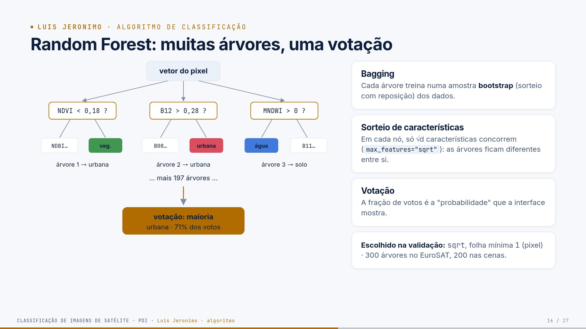
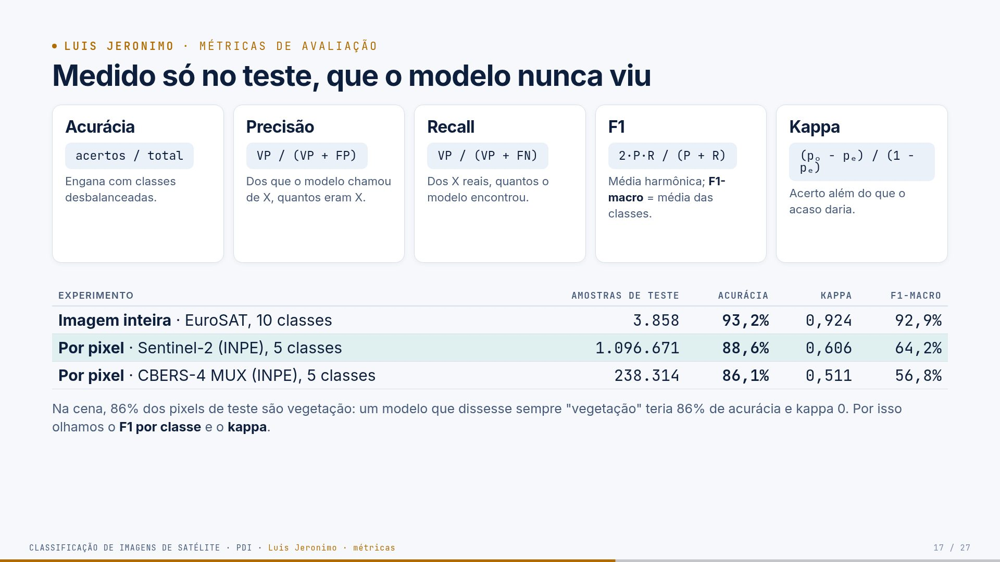
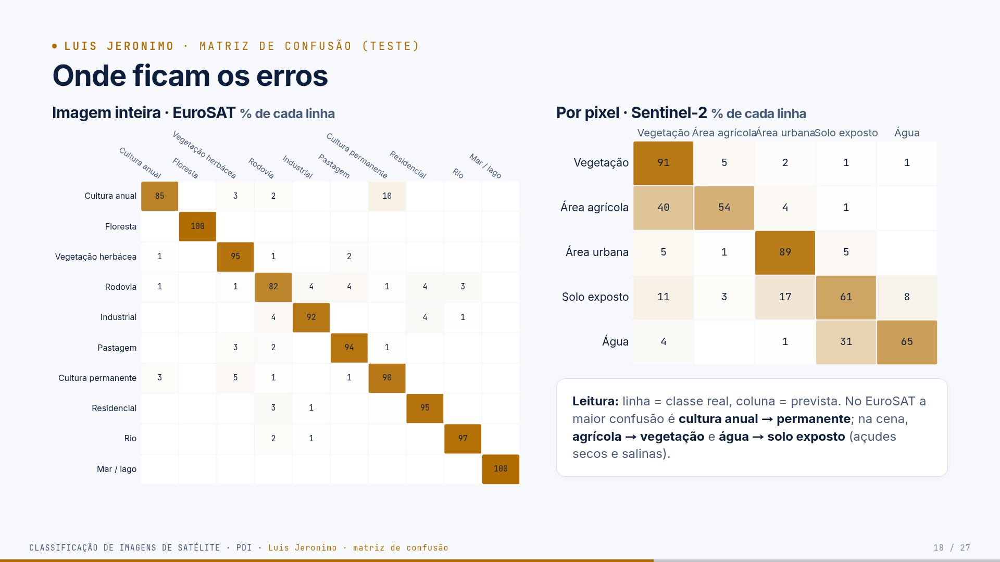
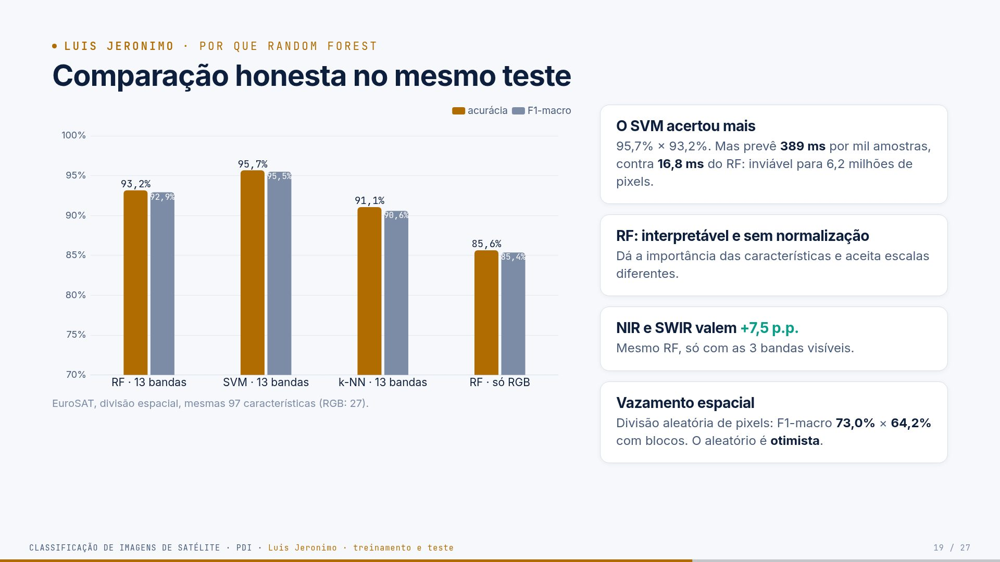

# Guia — Luis Jeronimo · slides 16 a 19

**Seu papel:** explicar o algoritmo, como ele foi treinado e como foi medido. Tempo-alvo: ~4,5 min.
Você recebe o vetor de características do Eduardo e entrega ao Paulo os números de teste.

## Parte 1 — O trabalho inteiro (todos precisam saber)

> Leia esta parte mesmo que seu trecho seja outro: o professor pode perguntar qualquer coisa a
> qualquer um. O passo a passo completo, com código, está no [guia geral](guia-geral.md).

**Em uma frase:** pegamos imagens de satélite do **INPE** sobre **Mossoró/RN**, transformamos
cada pixel em números (bandas, índices espectrais, textura) e treinamos um **Random Forest** que
diz se o pixel é **vegetação, área agrícola, área urbana, solo exposto ou água**, medindo o acerto
em partes da cena que o modelo nunca viu.

### Os dados

- **Sentinel-2B L1C** (INPE · Brazil Data Cube), 01/09/2024: 13 bandas, 10 m, 6,2 milhões de pixels.
- **CBERS-4 MUX** (INPE · Brazil Data Cube), 04/10/2024: 4 bandas (sem SWIR), 20 m.
- **EuroSAT MS**: 27.000 recortes 64×64 de 13 bandas, rotulados em 10 classes (Europa).
- **ESA WorldCover 2021**: mapa de 10 m usado como **gabarito** de cada pixel de Mossoró.

**As nove etapas** (cada uma é um arquivo em `src/`)

| # | etapa | o que acontece | quem apresenta |
|---|---|---|---|
| 1 | aquisição | baixa as cenas pelo catálogo STAC do INPE, recorta Mossoró, alinha as bandas em 10 m | Ana / Cindy |
| 2 | exploração | composições coloridas, assinaturas espectrais, proporção das classes | Ana / Cindy |
| 3 | pré-processamento | número digital → reflectância (com a correção de −1000), máscara de nuvem | Cindy |
| 4 | características | 22 números por pixel (bandas, NDVI, NDWI, MNDWI, NDBI, BSI, vizinhança 5×5); 97 por recorte | Eduardo |
| 5 | amostras | a cena é cortada em blocos de 1,28 km: treino, validação e teste nunca são vizinhos | Cindy |
| 6 | treino | Random Forest; hiperparâmetros escolhidos na validação | Luis |
| 7 | avaliação | acurácia, precisão, recall, F1, kappa, matriz de confusão, só no teste | Luis |
| 8 | mapa | todos os pixels classificados em ~27 s; filtro de moda 3×3 | Paulo |
| 9 | erros | mapa de erros, exemplos e causas | Paulo |

**Três níveis de classificação:** *imagem inteira* (1 recorte → 1 classe, EuroSAT), *por pixel*
(mapa de Mossoró) e *por região* (janela de 640 m deslizando pela cena com o modelo do EuroSAT).

**Os números principais** (teste)

| experimento | acurácia | kappa | F1-macro |
|---|---|---|---|
| imagem inteira · EuroSAT | 93,2% | 0,924 | 92,9% |
| pixel · Sentinel-2 | 88,6% (89,2% com filtro de moda) | 0,606 | 64,2% |
| pixel · CBERS-4 | 86,1% | 0,511 | 56,8% |
| região · EuroSAT → Mossoró | 62,8% de concordância | — | — |

Três lições que todos devem saber explicar:

1. **82% da área é vegetação**: por isso a acurácia é alta e o F1-macro, menor.
2. **NIR e SWIR importam**: sem eles, o EuroSAT cai de 93,2% para 85,6%, e o CBERS (sem SWIR)
   confunde cidade com solo.
3. **Vazamento espacial**: sortear pixels em vez de blocos inflaria o F1-macro de 64% para 73%.

---

## Parte 2 — Fundamentos do seu tema

### 2.1 Aprendizado supervisionado

O modelo recebe pares (características, classe) no treino e aprende uma função que leva
características em classes. Depois, recebe só as características e prevê a classe.

### 2.2 Árvore de decisão

Uma árvore faz perguntas binárias em sequência: "NDVI ≤ 0,20?". Cada resposta leva a um ramo, até
uma **folha**, que dá a classe.

**Como a árvore escolhe a pergunta:** testa várias características e limiares e escolhe o que deixa
os dois grupos resultantes mais "puros". A pureza é medida pela **impureza de Gini**:

  Gini = 1 − Σₖ pₖ²

Exemplo: um nó com 50% vegetação e 50% água tem Gini = 1 − (0,5² + 0,5²) = 0,5. Um nó só com água
tem Gini = 1 − 1² = 0. A pergunta escolhida é a que mais reduz o Gini médio dos filhos.

**Problema:** uma árvore profunda separa perfeitamente o treino, inclusive o ruído (**sobreajuste**).

### 2.3 Random Forest

1. **Bootstrap:** cada árvore recebe uma amostra sorteada **com reposição** do treino, do mesmo
   tamanho (≈63% de amostras distintas; o resto se repete).
2. **Sorteio de características:** em cada nó, só √d características são candidatas
   (d = 22 → 4 por pixel; d = 97 → 9 por recorte).
3. **Votação:** a classe final é a mais votada; a fração de votos é a "probabilidade".

Como cada árvore vê dados e características diferentes, elas erram em lugares diferentes, e a
média dos votos reduz a variância. O preço é perder a interpretação de uma árvore única, mas a
importância das características compensa.

### 2.4 Hiperparâmetros

São ajustes definidos antes do treino:

- `n_estimators`: número de árvores (300 no EuroSAT, 200 nas cenas). Mais árvores nunca pioram,
  só deixam mais lento.
- `max_features`: quantas características concorrem em cada nó (`sqrt`).
- `min_samples_leaf`: tamanho mínimo da folha (1 ou 3). Folhas maiores = árvores mais simples.
- `class_weight`: peso das classes (balanceado no EuroSAT; nas cenas, a amostragem já trata).

Foram testadas 4 combinações e escolhida a de maior F1-macro na **validação**.

### 2.5 Os outros algoritmos comparados

- **SVM (máquina de vetores de suporte):** procura a fronteira com a maior margem entre as
  classes; o kernel RBF permite fronteiras curvas. Precisa de normalização. Na predição, compara a
  amostra com todos os vetores de suporte, por isso é lento.
- **k-NN (k vizinhos mais próximos):** não treina; para classificar, procura as 7 amostras de
  treino mais parecidas e faz votação. Precisa de normalização; é lento com muitas amostras.

### 2.6 Métricas

Para cada classe X: **VP** (era X, disse X), **FP** (não era X, disse X), **FN** (era X, disse outra).

| métrica | fórmula | intuição |
|---|---|---|
| acurácia | acertos/total | "quanto acertou no geral" (engana com desbalanceamento) |
| precisão | VP/(VP+FP) | "quando ele diz X, posso confiar?" |
| recall | VP/(VP+FN) | "ele encontra os X?" |
| F1 | 2PR/(P+R) | média harmônica: só é alta se as duas forem |
| F1-macro | média simples dos F1 | cada classe pesa igual |
| kappa | (pₒ − pₑ)/(1 − pₑ) | acerto além do acaso |

**Matriz de confusão:** tabela com a classe real nas linhas e a prevista nas colunas. A diagonal
são os acertos; dividindo cada linha pelo total, a diagonal vira o recall.

---

## Parte 3 — Slide a slide (o que dizer)

## Slide 16 · Random Forest: muitas árvores, uma votação

### Árvore de decisão

Uma sequência de perguntas do tipo "característica < limiar?". Em cada nó, o algoritmo
escolhe a pergunta que mais **reduz a impureza de Gini** dos dois grupos resultantes:

  Gini = 1 − Σₖ pₖ²  (pₖ = fração da classe k no nó; 0 = nó puro)

Sozinha, uma árvore profunda **decora** o treino (variância alta).

### Random Forest (Breiman, 2001)

1. **Bagging:** cada árvore treina numa amostra **bootstrap**, isto é, sorteada com reposição,
   do mesmo tamanho do treino. Cerca de 63% das amostras distintas entram em cada árvore.
2. **Sorteio de características:** em cada nó, só **√d** características concorrem
   (`max_features="sqrt"`; d = 97 → 9 no EuroSAT; d = 22 → 4 por pixel). As árvores ficam
   diferentes entre si.
3. **Votação:** cada árvore vota numa classe, e a classe final é a mais votada. A **fração
   de votos** é a "probabilidade" que a interface mostra.

Árvores diferentes erram em lugares diferentes; a votação cancela parte desses erros
(reduz a variância sem aumentar o viés).

**As perguntas no diagrama** ("NDVI < 0,18?", "B12 > 0,28?", "MNDWI > 0?") são
**ilustrativas**: mostram o tipo de teste que as árvores fazem, com características reais
do modelo. O modelo real tem 200 árvores com milhares de nós cada.

### Hiperparâmetros (escolhidos na validação)

| | EuroSAT | Sentinel-2 | CBERS-4 |
|---|---|---|---|
| árvores (`n_estimators`) | 300 | 200 | 200 |
| `max_features` | sqrt | sqrt | sqrt |
| `min_samples_leaf` | 1 | 1 | 3 |
| `class_weight` | balanced | — (a amostragem trata) | — |

Grade testada: `max_features` ∈ {sqrt, 0,3} × `min_samples_leaf` ∈ {1, 3}. O critério foi o
F1-macro na validação (EuroSAT: 0,926 com sqrt/1; S2: 0,718 com sqrt/1). Depois disso, o
modelo é retreinado e medido no teste **uma única vez**.

**Fala:**
> "Uma árvore de decisão faz perguntas sobre as características até chegar numa classe. O
> problema é que uma árvore sozinha decora o treino. O Random Forest treina centenas de
> árvores, cada uma com uma amostra sorteada dos dados e, em cada pergunta, só uma parte das
> características. Como elas erram em lugares diferentes, a votação cancela os erros. A
> fração de votos é a confiança que aparece na interface."

---

## Slide 17 · Medido só no teste, que o modelo nunca viu

Para a classe X: **VP** = era X e o modelo disse X; **FP** = não era X e o modelo disse X;
**FN** = era X e o modelo disse outra coisa.

| métrica | fórmula | pergunta que responde |
|---|---|---|
| acurácia | acertos / total | quantos pixels o modelo acertou? |
| precisão | VP / (VP + FP) | quando o modelo diz X, quanto acerta? |
| recall | VP / (VP + FN) | dos X reais, quantos encontrou? |
| F1 | 2·P·R / (P + R) | equilíbrio entre precisão e recall |
| F1-macro | média simples do F1 das classes | todas as classes valem o mesmo |
| kappa | (pₒ − pₑ) / (1 − pₑ) | quanto o acerto supera o acaso |

pₒ = acurácia observada; pₑ = acurácia esperada se as previsões fossem sorteadas com as mesmas
proporções (Cohen, 1960).

**Resultados no teste:**

| experimento | n teste | acurácia | kappa | F1-macro |
|---|---|---|---|---|
| imagem inteira · EuroSAT, 10 classes | 3.858 | 93,2% | 0,924 | 92,9% |
| pixel · Sentinel-2, 5 classes | 1.096.671 | 88,6% | 0,606 | 64,2% |
| pixel · CBERS-4, 5 classes | 238.314 | 86,1% | 0,511 | 56,8% |

**A armadilha da acurácia:** 86% dos pixels de teste da cena são vegetação. Um "modelo" que
sempre respondesse vegetação teria 86% de acurácia e **kappa 0**. O nosso tem 88,6% e kappa
0,606: o ganho real está nas outras classes, e o F1-macro e o kappa mostram isso.

**Escala de Landis e Koch (1977) para o kappa:** 0,41–0,60 moderado; 0,61–0,80 substancial;
> 0,80 quase perfeito. O S2 fica em 0,606 (no limite) e passa a 0,620 com o filtro de moda.
O EuroSAT, com 0,924, é quase perfeito.

**Fala:**
> "Medimos tudo no teste, que o modelo nunca viu, nem na escolha dos hiperparâmetros. A
> acurácia da cena é 88,6%, mas cuidado: 86% dos pixels são vegetação. Um modelo que só
> dissesse 'vegetação' teria 86% e kappa zero. Por isso olhamos o kappa, 0,61, e o
> F1-macro, que dá o mesmo peso à água e à vegetação."

---

## Slide 18 · Onde ficam os erros

**Leitura:** linha = classe real, coluna = classe prevista, valores em % da linha. A
diagonal é o **recall** de cada classe.

**EuroSAT, maiores confusões (contagens no teste):**

- cultura anual → cultura permanente: 42 (ambas são campos cultivados com padrão regular)
- cultura permanente → vegetação herbácea: 17
- residencial → rodovia, rodovia → pastagem e industrial → rodovia: 14 cada
- floresta (100%) e mar/lago (100%) quase não erram

**Sentinel-2, por pixel:**

- agrícola: só 54% de recall; 40% vai para vegetação (pousio e caatinga seca)
- água: 65% de recall; 31% vira solo exposto (açudes que secaram entre 2021 e 2024, salinas)
- solo exposto: 61% de recall; 17% vira urbano
- urbano: 89% de recall

**Fala:**
> "A matriz mostra onde o modelo erra. No EuroSAT, a maior confusão é entre dois tipos de
> cultivo, que de fato são parecidos. Na cena, os erros também têm explicação física: área
> agrícola em pousio parece caatinga seca, e um açude que secou entre a data da referência e
> a da imagem vira solo exposto."

---

## Slide 19 · Comparação no mesmo teste

**Modelos no mesmo teste espacial do EuroSAT, mesmas 97 características:**

| modelo | acurácia | F1-macro | treino | predição (ms por 1000 amostras) |
|---|---|---|---|---|
| **Random Forest** | 93,2% | 92,9% | 15 s | **16,8** |
| SVM (kernel RBF, C = 10) | **95,7%** | **95,5%** | 2 s | 388,8 |
| k-NN (k = 7) | 91,1% | 90,6% | 0 s | 60,0 |
| Random Forest só RGB (27 características) | 85,6% | 85,4% | 7 s | 24,8 |

SVM e k-NN usam `StandardScaler` ajustado no treino (são sensíveis à escala).

**Por que Random Forest, se o SVM acertou mais?**

- **Custo no mapa:** o SVM é ~23× mais lento na predição. Para 6,2 milhões de pixels, isso
  significa vários minutos contra 27 s. (Ressalva honesta: o RF usa os 8 núcleos e o SVM do
  scikit-learn usa um; mesmo assim, a predição do SVM RBF cresce com o número de vetores de suporte.)
- **Interpretabilidade:** importância das características e votação explicável.
- **Sem normalização** e robusto a escalas diferentes (reflectância, índices, textura).
- **Desempenho próximo:** 2,5 p.p. abaixo do SVM.

**NIR e SWIR valem +7,5 p.p.:** o mesmo RF, só com as 3 bandas visíveis, cai para 85,6%.
É a resposta para "vale a pena usar imagem multiespectral?".

**Vazamento espacial, medido:**

| | divisão aleatória | divisão espacial |
|---|---|---|
| EuroSAT, acurácia | 94,0% | 93,2% |
| Sentinel-2, F1-macro | **73,0%** | **64,2%** |
| CBERS-4, F1-macro | 63,6% | 56,8% |

Na cena, sortear pixels inflaria o F1-macro em quase 9 pontos sem o modelo ser melhor. No
EuroSAT a diferença é pequena porque os recortes já estão espalhados por 34 países.

**Fala (com transição):**
> "Não escondemos: o SVM foi melhor no EuroSAT, 95,7 contra 93,2. Mas ele é 23 vezes mais
> lento para prever, e o nosso objetivo final é um mapa de 6 milhões de pixels. O Random
> Forest é rápido, interpretável e não precisa de normalização. Duas outras lições: sem
> NIR e SWIR o mesmo modelo perde 7,5 pontos; e, se tivéssemos sorteado pixels em vez de
> blocos, o F1 da cena pareceria 9 pontos melhor. O Paulo mostra agora os resultados e o mapa."

---

---

## Parte 4 — Exemplos com números reais

**O caminho de um pixel na árvore nº 1** (pixel urbano (1336, 937), valores reais):

| nó | pergunta | valor | resposta |
|---|---|---|---|
| 1 | NDVI ≤ 0,200? | 0,245 | não |
| 2 | B8A ≤ 0,296? | 0,347 | não |
| 3 | B03 ≤ 0,114? | 0,182 | não |
| 4 | NDVI_media5x5 ≤ 0,201? | 0,189 | sim |
| 5 | BSI ≤ 0,175? | 0,064 | sim |
| 6 | NIR_desvio5x5 ≤ 0,009? | 0,022 | não |
| … | mais 11 perguntas | | folha: **Área urbana** |

Votos das 200 árvores para esse pixel: urbana 94%, agrícola 3,5%, solo 1,5%, vegetação 1%. As
árvores do modelo da cena têm, em média, 32 níveis e ~4.100 folhas.

**Kappa à mão (Sentinel-2, teste):**

- pₒ = acurácia = 0,886;
- pₑ = Σ (fração real da classe × fração prevista da classe) = 0,711 (alto, porque quase tudo é vegetação);
- kappa = (0,886 − 0,711)/(1 − 0,711) = 0,175/0,289 = **0,606**.

**Precisão e recall da área urbana (Sentinel-2):**

- linha "urbana" da matriz (real): 3.261 → vegetação, 411 → agrícola, **54.209 → urbana**,
  2.784 → solo, 13 → água. Recall = 54.209/60.678 = **0,893**.
- coluna "urbana" (prevista): 18.165 eram vegetação, 2.047 agrícola, **54.209 urbana**, 3.436 solo,
  136 água. Precisão = 54.209/77.993 = **0,695**.
- F1 = 2·0,695·0,893/(0,695 + 0,893) = **0,782**.

A precisão é menor que o recall: o modelo "chama de cidade" um pouco de vegetação nas bordas da
mancha urbana.

**Comparação de tempo (predição de 1000 recortes):** RF 16,8 ms; k-NN 60 ms; SVM 388,8 ms. Para 6,2
milhões de pixels, o SVM levaria vários minutos; o RF leva ~27 s.

---

## Parte 5 — Perguntas prováveis e respostas

### "Por que 200 ou 300 árvores?"

O erro do Random Forest estabiliza à medida que o número de árvores cresce; ele não piora
com mais árvores, só fica mais lento. 200–300 é um valor comum na literatura de
sensoriamento remoto (Belgiu e Drăguţ, 2016). O ganho acima disso foi desprezível.

### "Usaram validação cruzada?"

No EuroSAT, a divisão usa `StratifiedGroupKFold` (7 dobras) para formar treino, validação e
teste por grupos. Não fizemos as 7 rodadas de validação cruzada completas; isso está nas
melhorias, para dar um intervalo de confiança às métricas.

### "O que é o OOB score?"

É a acurácia medida nas amostras que ficaram fora do bootstrap de cada árvore. Não a usamos
porque, com vizinhos espaciais, o OOB sofre o mesmo vazamento da divisão aleatória.

### "Por que `class_weight='balanced'` no EuroSAT e não nas cenas?"

No EuroSAT, as classes têm de 2.000 a 3.000 recortes, e o peso corrige essa pequena
diferença. Nas cenas, o desbalanceamento é tratado na amostragem (raiz da frequência);
somar pesos balanceados por cima faria o modelo superestimar as classes raras.

### "O kappa ainda é recomendado?"

Há críticas ao kappa em mapeamento (Pontius e Millones, 2011), por isso reportamos também a
matriz de confusão e o F1 por classe. O kappa aparece porque é pedido com frequência e
mostra bem a armadilha do desbalanceamento.

### "Como a interface calcula a 'probabilidade'?"

`predict_proba` devolve a fração das árvores que votou em cada classe (média das probabilidades
das folhas, no scikit-learn).

### "Por que o F1 da área agrícola é tão baixo (0,43)?"

Recall de 0,54 e precisão de 0,36. Muitos campos estão em pousio na seca e parecem caatinga; e
caatinga com vegetação verde perto de açudes parece cultivo. A referência também é incerta nessa classe.

### "O modelo está sobreajustado, com folha mínima 1?"

Cada árvore isoladamente, sim; a floresta, não. A votação compensa, e a validação mostrou que folha
1 foi a melhor. A medida que importa é o teste por blocos, que o modelo nunca viu.

### "Por que medir no teste só uma vez?"

Se escolhermos configurações olhando o teste, ele deixa de ser independente e a métrica fica otimista.
Por isso existe a validação.

---

## Parte 6 — Transição para o Paulo

> "…O Paulo mostra agora os resultados e o mapa."
---

## Checklist antes do seminário

- [ ] Sei explicar Gini, bootstrap e votação.
- [ ] Sei calcular precisão, recall e F1 a partir de uma linha e uma coluna da matriz.
- [ ] Sei justificar o RF mesmo com o SVM 2,5 p.p. melhor.
- [ ] Li a **Parte 1** e sei explicar o trabalho inteiro em 1 minuto.
- [ ] Sei os números da minha parte sem olhar.
- [ ] Ensaiei a transição para o próximo integrante.
- [ ] Abri os slides (`presentation/index.html`) e testei `S` (notas) e `T` (tema).
