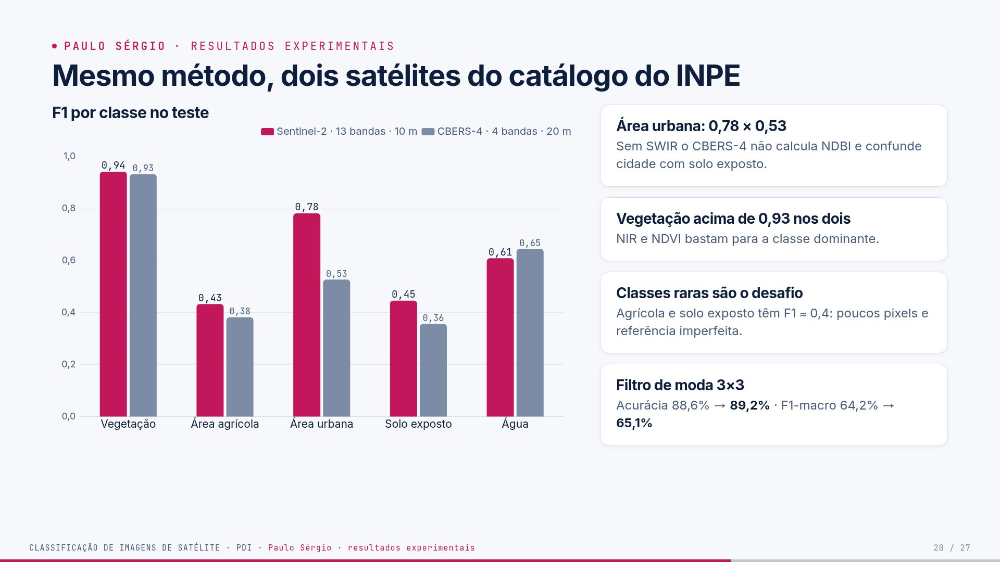
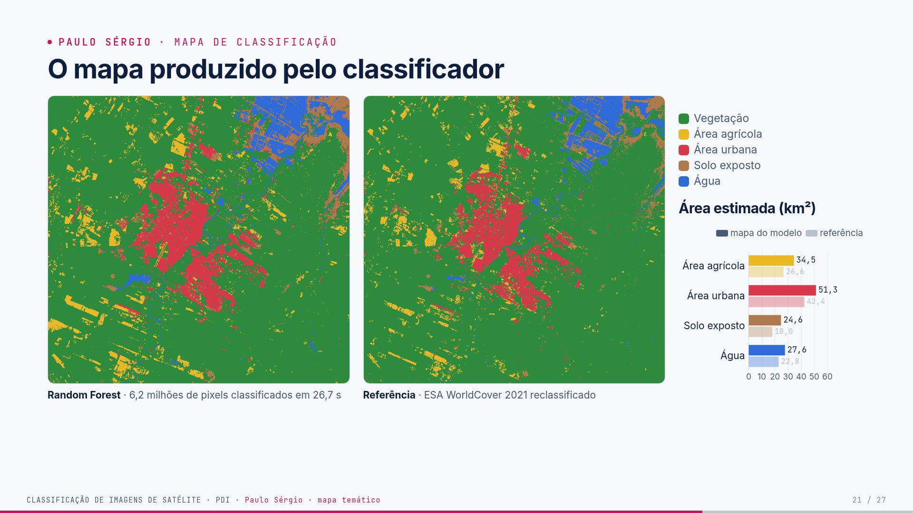
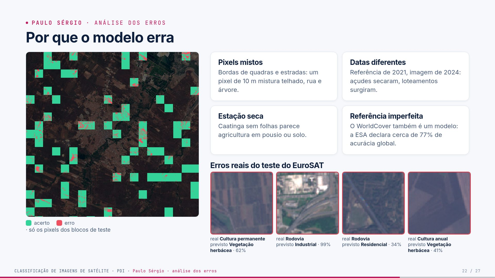
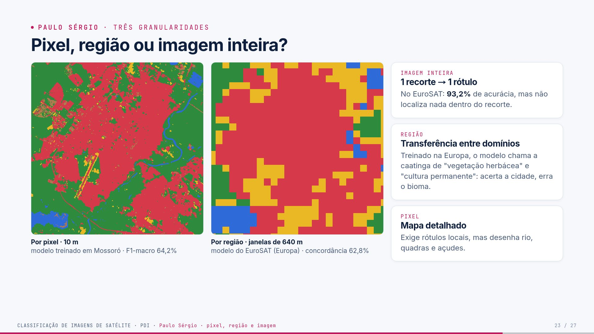
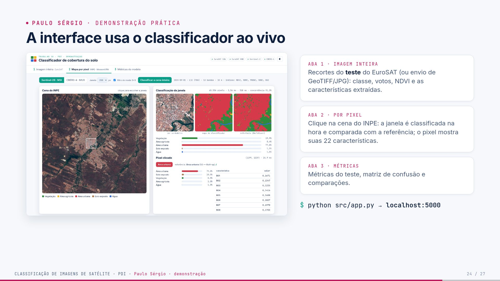
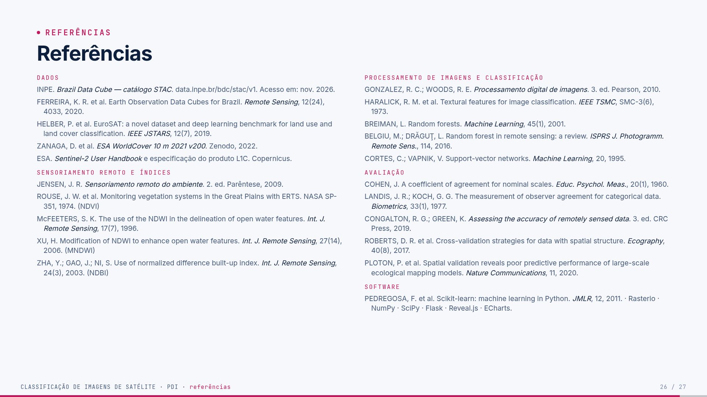

# Guia — Paulo Sérgio · slides 20 a 27

**Seu papel:** mostrar o produto final (o mapa), analisar os erros, comparar as três granularidades,
fazer a demonstração ao vivo e fechar (conclusão, referências e agradecimento). Tempo-alvo: ~7,5
min, sendo ~1,5 min de demonstração. Você é o último: precisa amarrar a história inteira.

## Parte 1 — O trabalho inteiro (todos precisam saber)

> Leia esta parte mesmo que seu trecho seja outro: o professor pode perguntar qualquer coisa a
> qualquer um. O passo a passo completo, com código, está no [guia geral](guia-geral.md).

**Em uma frase:** pegamos imagens de satélite do **INPE** sobre **Mossoró/RN**, transformamos
cada pixel em números (bandas, índices espectrais, textura) e treinamos um **Random Forest** que
diz se o pixel é **vegetação, área agrícola, área urbana, solo exposto ou água**, medindo o acerto
em partes da cena que o modelo nunca viu.

### Os dados

- **Sentinel-2B L1C** (INPE · Brazil Data Cube), 01/09/2024: 13 bandas, 10 m, 6,2 milhões de pixels.
- **CBERS-4 MUX** (INPE · Brazil Data Cube), 04/10/2024: 4 bandas (sem SWIR), 20 m.
- **EuroSAT MS**: 27.000 recortes 64×64 de 13 bandas, rotulados em 10 classes (Europa).
- **ESA WorldCover 2021**: mapa de 10 m usado como **gabarito** de cada pixel de Mossoró.

**As nove etapas** (cada uma é um arquivo em `src/`)

| # | etapa | o que acontece | quem apresenta |
|---|---|---|---|
| 1 | aquisição | baixa as cenas pelo catálogo STAC do INPE, recorta Mossoró, alinha as bandas em 10 m | Ana / Cindy |
| 2 | exploração | composições coloridas, assinaturas espectrais, proporção das classes | Ana / Cindy |
| 3 | pré-processamento | número digital → reflectância (com a correção de −1000), máscara de nuvem | Cindy |
| 4 | características | 22 números por pixel (bandas, NDVI, NDWI, MNDWI, NDBI, BSI, vizinhança 5×5); 97 por recorte | Eduardo |
| 5 | amostras | a cena é cortada em blocos de 1,28 km: treino, validação e teste nunca são vizinhos | Cindy |
| 6 | treino | Random Forest; hiperparâmetros escolhidos na validação | Luis |
| 7 | avaliação | acurácia, precisão, recall, F1, kappa, matriz de confusão, só no teste | Luis |
| 8 | mapa | todos os pixels classificados em ~27 s; filtro de moda 3×3 | Paulo |
| 9 | erros | mapa de erros, exemplos e causas | Paulo |

**Três níveis de classificação:** *imagem inteira* (1 recorte → 1 classe, EuroSAT), *por pixel*
(mapa de Mossoró) e *por região* (janela de 640 m deslizando pela cena com o modelo do EuroSAT).

**Os números principais** (teste)

| experimento | acurácia | kappa | F1-macro |
|---|---|---|---|
| imagem inteira · EuroSAT | 93,2% | 0,924 | 92,9% |
| pixel · Sentinel-2 | 88,6% (89,2% com filtro de moda) | 0,606 | 64,2% |
| pixel · CBERS-4 | 86,1% | 0,511 | 56,8% |
| região · EuroSAT → Mossoró | 62,8% de concordância | — | — |

Três lições que todos devem saber explicar:

1. **82% da área é vegetação**: por isso a acurácia é alta e o F1-macro, menor.
2. **NIR e SWIR importam**: sem eles, o EuroSAT cai de 93,2% para 85,6%, e o CBERS (sem SWIR)
   confunde cidade com solo.
3. **Vazamento espacial**: sortear pixels em vez de blocos inflaria o F1-macro de 64% para 73%.

---

## Parte 2 — Fundamentos do seu tema

### 2.1 Mapa temático

Um **mapa temático** mostra uma única informação (aqui, a classe de cobertura) com uma cor por
classe e uma legenda. Ele é o produto de uma classificação por pixel: cada pixel da imagem vira um
pixel do mapa. O nosso é salvo como GeoTIFF com georreferência (`results/predictions/s2_map.tif`),
o que permite abri-lo no QGIS por cima de outros mapas e **medir áreas**: cada pixel de 10 m vale 100 m² = 0,0001 km².

### 2.2 Pós-processamento: filtro de moda

Depois de classificar, alguns pixels isolados recebem uma classe diferente da vizinhança (ruído
de classificação, o efeito "sal e pimenta"). O **filtro de moda 3×3** troca cada rótulo pelo mais
frequente nos 9 pixels da janela. É um filtro não linear, como a mediana, mas para categorias.

```text
antes            depois
V V V            V V V
V U V    →       V V V      (o pixel urbano isolado vira vegetação)
V V V            V V V
```

### 2.3 Avaliar um mapa contra uma referência

A concordância mede quantos pixels coincidem com o gabarito. Ela depende da qualidade da
referência: se o gabarito erra, parte do "erro" medido é dele. O WorldCover 2021 tem acurácia
declarada em torno de 77% e é de 2021, enquanto a nossa imagem é de 2024.

### 2.4 Três granularidades

| | por pixel | por região | imagem inteira |
|---|---|---|---|
| unidade | pixel de 10 m | janela de 64×64 px (640 m), passo de 32 px | recorte de 640 m |
| modelo | treinado na própria cena | treinado no EuroSAT (Europa) | treinado no EuroSAT |
| saída | mapa detalhado | mapa em blocos | um rótulo |
| quando usar | mapear onde está cada coisa | quando só há rótulos de recortes | catalogar imagens |

### 2.5 Transferência entre domínios

Um modelo aprende as características do **domínio** em que foi treinado (região, bioma, sensor,
época). Fora dele, o desempenho cai. O modelo do EuroSAT nunca viu caatinga e a classifica como
"vegetação herbácea" ou "cultura permanente". Para usar em outro lugar, é preciso retreinar ou
ajustar com amostras locais.

### 2.6 A interface

Um servidor Flask (`src/app.py`) carrega os modelos; a página (`web/`) envia pedidos e mostra as
respostas. Cada resposta traz o tempo da inferência, o que prova que é calculada na hora. Detalhes
completos no [guia da demonstração](guia-demonstracao.md).

---

## Parte 3 — Slide a slide (o que dizer)

## Slide 20 · Mesmo método, dois satélites do catálogo do INPE



F1 por classe no teste (mesma área, mesma referência, mesmo protocolo):

| classe | Sentinel-2 (13 bandas, 10 m) | CBERS-4 MUX (4 bandas, 20 m) |
|---|---|---|
| Vegetação | 0,942 | 0,933 |
| Área agrícola | 0,433 | 0,382 |
| Área urbana | **0,782** | **0,527** |
| Solo exposto | 0,446 | 0,356 |
| Água | 0,609 | 0,645 |

**Leituras:**

- **Urbano: 0,78 × 0,53.** Sem SWIR, o CBERS não calcula NDBI nem MNDWI e confunde cidade com
  solo exposto: ambos são claros no visível. Esse é o efeito do sensor, não do algoritmo.
- **Vegetação acima de 0,93 nos dois:** NIR e NDVI bastam para a classe dominante.
- **Água ligeiramente melhor no CBERS:** a cena é de outubro (um mês depois) e tem
  reflectância de superfície (L4 SR), mas a diferença é pequena.
- **Classes raras (agrícola, solo) com F1 ≈ 0,4:** poucos pixels e referência imperfeita.
- **Filtro de moda 3×3** (`preprocessing.majority_filter`): acurácia 88,6% → 89,2%, F1-macro
  64,2% → 65,1%. É uma operação de vizinhança típica de PDI: cada pixel recebe a classe mais
  frequente da janela 3×3.

**Fala:**
> "Com o mesmo método nos dois satélites do catálogo do INPE, a diferença aparece onde
> esperávamos: na área urbana, o Sentinel-2 chega a 0,78 e o CBERS fica em 0,53, porque não
> tem o SWIR para separar cidade de solo. E um filtro de moda simples, depois da
> classificação, melhora tudo um pouco, eliminando pixels isolados."

---

## Slide 21 · O mapa produzido pelo classificador



**O que é:** o produto final. Cada um dos **6.246.636 pixels** válidos recebeu uma classe do
Random Forest em **26,7 s** (`train._predict_chunks`, depois o filtro de moda). Ao lado está a
referência (WorldCover 2021 reclassificado). Arquivos: `results/predictions/s2_map.tif`
(GeoTIFF com paleta, abre no QGIS) e `presentation/img/s2_mapa.png`.

**Área estimada (km²), modelo × referência:**

| classe | modelo | referência |
|---|---|---|
| Vegetação | 486,7 | 514,8 |
| Área agrícola | 34,5 | 26,6 |
| Área urbana | 51,3 | 42,4 |
| Solo exposto | 24,6 | 18,0 |
| Água | 27,6 | 22,8 |

O modelo **superestima** agrícola, urbano, solo e água e **subestima** vegetação. Isso é
consistente com a amostragem pela raiz da frequência, que dá mais peso às classes raras.
Parte da diferença urbana é real: Mossoró cresceu entre 2021 e 2024 (loteamentos novos).

**Fala:**
> "Este é o mapa que o classificador produziu: seis milhões de pixels em menos de 30
> segundos. A cidade, o rio e as salinas aparecem sem que ninguém tenha desenhado nada. Ao
> lado, a referência. O modelo estima um pouco mais de área urbana e agrícola do que a
> referência, e parte disso é real: a cidade cresceu de 2021 para 2024."

---

## Slide 22 · Por que o modelo erra



**Mapa de erros:** só os pixels dos **blocos de teste** (verde = acerto, vermelho = erro); o
resto fica escurecido. Os erros se concentram nas **bordas** entre classes.

**Quatro causas:**

1. **Pixels mistos:** um pixel de 10 m na borda de uma quadra mistura telhado, rua e árvore.
2. **Datas diferentes:** a referência é de 2021 e a imagem, de setembro de 2024. Açudes secaram
   e loteamentos surgiram.
3. **Estação seca:** caatinga sem folhas parece agricultura em pousio ou solo.
4. **Referência imperfeita:** o WorldCover também é um produto de classificação (a ESA
   declara acurácia global em torno de 77%). Parte do "erro" é erro da referência.

**Erros reais do teste do EuroSAT** (`figures.error_examples`, pares mais confundidos):

- cultura permanente → vegetação herbácea (62% dos votos)
- **rodovia → industrial (99%)**: o recorte mostra um trevo ao lado de grandes galpões
  brancos; há mais galpão do que estrada no recorte, e o rótulo "rodovia" é discutível
- rodovia → residencial (34%)
- cultura anual → vegetação herbácea (41%)

Confiança baixa (34–62%) indica um caso ambíguo; a interface mostra esse valor.

**Fala:**
> "Onde o modelo erra? Nas bordas, onde um pixel mistura telhado e rua; em lugares que
> mudaram entre 2021 e 2024; e porque a própria referência erra. Aqui embaixo, erros reais
> do teste: esta rodovia foi chamada de industrial com 99% de confiança, e olhando o recorte
> dá para entender — tem mais galpão do que estrada."

---

## Slide 23 · Pixel, região ou imagem inteira?



**O professor pediu para diferenciar claramente as três.** O mesmo recorte do centro de
Mossoró aparece nas duas primeiras imagens:

| | por pixel | por região | imagem inteira |
|---|---|---|---|
| unidade | pixel de 10 m | janela de 64×64 px (640 m), passo de 32 px | recorte de 640 m |
| modelo | treinado em Mossoró (WorldCover) | treinado no EuroSAT (Europa) | treinado no EuroSAT |
| saída | mapa detalhado | mapa em blocos | um rótulo |
| medida | F1-macro 64,2% | concordância de 62,8% com a referência | acurácia 93,2% |
| código | `predict.classify_scene` | `predict.region_map` | `predict.classify_chip` |

**Por região, em detalhe:** 5.850 janelas em 12 s. A classe do EuroSAT foi convertida em
macro-classe e comparada com a classe WorldCover majoritária da janela (solo exposto ficou
fora, porque não existe no EuroSAT). O modelo europeu chama a caatinga de **"vegetação
herbácea"** (3.116 janelas) e **"cultura permanente"** (1.202). Floresta: zero janelas.
Acerta 79% das janelas urbanas, mas só 60% das de vegetação.

**Lição: transferência entre domínios.** Um modelo vale para o domínio em que foi treinado.
O bioma caatinga não existe na Europa. Para usar o modelo aqui, seria preciso retreinar ou
ajustar com amostras locais.

**Por que a imagem inteira tem a "maior" acurácia?** A tarefa é mais fácil: o recorte foi
escolhido por um humano para representar bem uma classe (recortes "puros"). Na cena real,
há bordas e misturas. Os números não são diretamente comparáveis.

**Fala:**
> "As três granularidades no mesmo lugar. Por pixel, o mapa desenha o rio e as quadras. Por
> região, usamos o modelo do EuroSAT, treinado na Europa, em janelas de 640 metros: ele
> acerta a cidade, mas chama a caatinga de 'vegetação herbácea' e 'cultura permanente',
> porque nunca viu caatinga. E a imagem inteira dá um rótulo só para o recorte: 93% de
> acerto, mas sem localizar nada dentro dele."

---

## Slide 24 · Demonstração prática



**Antes do seminário:** `cd trab-10 && .venv/bin/python src/app.py` e deixe o navegador
aberto em `http://localhost:5000`. Na primeira chamada, a cena é carregada na memória (~3 s).

**Roteiro da demonstração (~90 s):**

1. **Aba 1 · Imagem inteira:** filtre por "Rio" e clique num recorte. Mostre as quatro
   composições, a classe, a confiança, "Classe real: Rio · ✓ acerto", os índices médios e a
   tabela de características. Diga que os recortes são do **teste**.
2. **Aba 2 · Mapa por pixel:** clique no centro de Mossoró. A janela de 256×256 px é
   classificada na hora (~300 ms) e aparece ao lado da referência, com a concordância. O pixel
   clicado mostra as 22 características e os votos.
3. Troque para **CBERS-4** e clique no mesmo lugar: o mapa fica mais grosseiro (20 m).
4. Se houver tempo: **"Classificar a cena inteira"** (~30 s no Sentinel-2, ~7 s no CBERS).
5. **Aba 3 · Métricas:** mostre a matriz de confusão e a linha "divisão aleatória (vazamento)".

**Se algo der errado:** as capturas estão em `presentation/img/demo_imagem.png`,
`demo_interface.png` e `demo_metricas.png`.

**Fala:**
> "A interface consome o modelo de verdade. Escolho um recorte do teste: o modelo responde
> 'Rio' com 94% dos votos, e mostra as características que usou. Agora clico no centro de
> Mossoró: essa janela de 65 mil pixels foi classificada agora, em 300 milissegundos, e
> concorda 91% com a referência. Nada aqui é resultado fixo; cada resposta mostra o tempo."

---

## Slide 25 · O que aprendemos (conclusão, aplicações, limitações e melhorias)


**Conclusão:** com dados abertos do INPE e um Random Forest, a cena de Mossoró virou um mapa
de 5 classes com **89,2%** de acurácia e kappa **0,62** em blocos nunca vistos.

**Aplicações:** monitorar a expansão urbana, o volume dos açudes ao fim da seca e a área
irrigada, com imagens novas a cada 5 dias e o mesmo código.

**Limitações (dizer com tranquilidade, elas são parte do resultado):**

- os rótulos vêm de outro modelo (WorldCover 2021), de outra data;
- uma única data, na estação seca;
- as classes raras têm F1 ≈ 0,4;
- o modelo europeu não transfere para a caatinga.

**Melhorias:**

- **série temporal:** uma imagem da seca e uma da chuva separam caatinga (verde só na chuva)
  de agricultura irrigada (verde o ano todo);
- **amostras de campo** ou interpretação visual para um gabarito local;
- **MapBiomas** como referência regional;
- **CNN** nos recortes (o artigo do EuroSAT chega a 98,6% com ResNet-50, segundo Helber et al.);
- validação cruzada espacial completa, para dar intervalos de confiança.

**Fala (os quatro cartões têm o mesmo peso; leia na ordem: conclusão, aplicações, limitações, melhorias):**
> "A implementação funciona de ponta a ponta: do download no catálogo do INPE ao mapa e à
> interface. E os resultados foram medidos de forma honesta, inclusive os que não favorecem o
> nosso modelo: o SVM foi melhor no EuroSAT, a divisão aleatória inflaria o resultado e o
> modelo europeu não serve para a caatinga."

---
---

## Slide 26 · Referências



Slide de consulta: **não leia a lista**. Diga apenas: "As referências estão agrupadas em dados,
sensoriamento remoto, processamento de imagens, classificação, avaliação e software; a lista
completa, com DOI e links, está em `docs/referencias.md`." Se o professor perguntar de onde vem
uma fórmula ou um método, os autores estão aqui (ex.: NDVI → Rouse et al., 1974; Random Forest →
Breiman, 2001; kappa → Cohen, 1960; GLCM → Haralick et al., 1973).

---

## Slide 27 · Agradecimento


Repete a faixa do espectro da capa e os cinco integrantes. **Fala:**
> "Obrigado pela atenção. Ficamos à disposição para perguntas e sugestões."

Deixe a interface aberta em outra aba: se surgir uma pergunta sobre um ponto da cena, dá para
mostrar na hora.

---

## Parte 4 — Exemplos com números reais

**Áreas (km²) na área de estudo, modelo × referência:** vegetação 486,7 × 514,8; agrícola 34,5 ×
26,6; urbana 51,3 × 42,4; solo 24,6 × 18,0; água 27,6 × 22,8. Conta: 4.866.900 pixels previstos como
vegetação × 0,0001 km² = 486,7 km².

**Desempenho por granularidade:** pixel F1-macro 64,2%; região 62,8% de concordância (vegetação
60%, urbano 79% das janelas); imagem inteira 93,2% de acurácia.

**Classificação por região:** 5.850 janelas em 12 s. O modelo europeu chamou 3.116 janelas de
"vegetação herbácea", 1.202 de "cultura permanente", 564 de "rodovia" e nenhuma de "floresta".

**Tempo de mapa:** 6.246.636 pixels em 26,7 s no Sentinel-2 (≈ 230 mil pixels por segundo);
1.426.356 pixels em 6,4 s no CBERS-4.

**Erros do EuroSAT mostrados no slide 22:** cultura permanente → vegetação herbácea (62% dos
votos); rodovia → industrial (99%); rodovia → residencial (34%); cultura anual → vegetação herbácea (41%).

---

## Parte 5 — Perguntas prováveis e respostas

### "Esse mapa é melhor que o WorldCover?"

Não dá para afirmar: medimos a concordância com ele. Para dizer qual é melhor, precisaríamos
de um gabarito independente (pontos de campo). O que o nosso mapa tem a mais é a data: ele
retrata setembro de 2024.

### "Por que o filtro de moda melhora a acurácia?"

Pixels isolados de uma classe no meio de outra são, na maioria, ruído de classificação. A moda
3×3 troca esses pixels pela classe da vizinhança. Exagerar na janela apagaria estradas e
canais estreitos, por isso usamos 3×3.

### "Quanto tempo leva para classificar uma cena Sentinel-2 inteira (110 × 110 km)?"

A nossa área tem 6,2 milhões de pixels e leva ~27 s. Uma cena completa tem ~120 milhões de
pixels, então ~9 min em 8 núcleos, processando em faixas para caber na memória.

### "A classificação por região serve para quê, se é pior?"

Ela mostra o que acontece quando se usa um modelo pronto fora do seu domínio, um erro comum.
Com amostras locais, a mesma janela deslizante funciona (é como se fazem mapas com CNN).

### "Como vocês garantem que a demonstração não usa dados de treino?"

Os recortes da aba 1 vêm de `eurosat_demo_samples.npz`, sorteados **só do conjunto de teste**
(`train.save_demo_samples`). Na aba 2, a concordância é calculada na janela inteira, incluindo
blocos de treino; as métricas oficiais (aba 3) usam só os blocos de teste.

### "Onde estão os números?"

Em `results/metrics/*.json`. Os slides leem esses valores de `presentation/data/dados.js`,
gerado por `presentation/scripts/exportar_dados.py`. Ninguém digitou número à mão nos slides.

### "Se fosse para usar de verdade, o que faltaria?"

Validar com pontos de campo, usar duas datas (seca e chuva), revisar a classe agrícola e
documentar a incerteza de cada classe junto com o mapa.

### "Por que o mapa tem mais área urbana que a referência?"

Duas razões: a amostragem dá mais peso às classes raras (o modelo prefere "chutar" urbano nas
bordas) e a cidade realmente cresceu de 2021 para 2024.

---

## Checklist antes do seminário

- [ ] Sei fazer a demonstração em 90 s (guia da demonstração, roteiro da aba 2).
- [ ] Sei explicar a diferença entre pixel, região e imagem inteira.
- [ ] Deixei o servidor aberto e as capturas `demo_*.png` como plano B.
- [ ] Li a **Parte 1** e sei explicar o trabalho inteiro em 1 minuto.
- [ ] Sei os números da minha parte sem olhar.
- [ ] Ensaiei a transição para o próximo integrante.
- [ ] Abri os slides (`presentation/index.html`) e testei `S` (notas) e `T` (tema).
